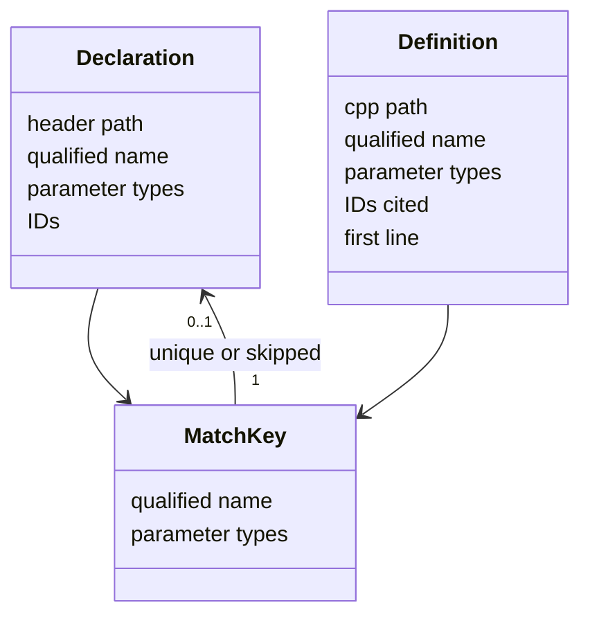
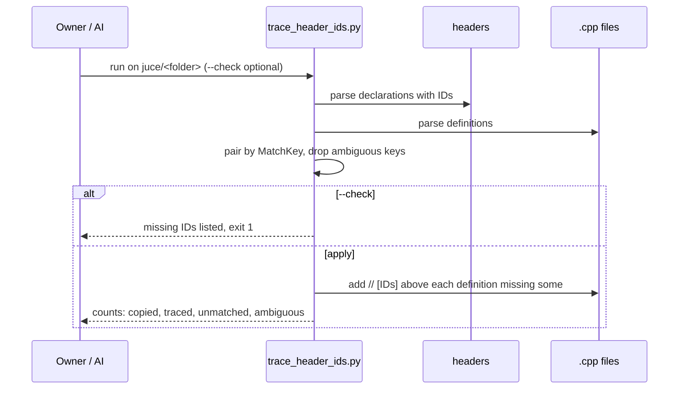

# ADR-QLT-003: Declaration-to-Definition ID Matching

## Status
Accepted — drafted in session QLT (2026-11-22) for FTR-QLT-003 (RQ-QLT-014 to RQ-QLT-016). Implementation is PLAN-QLT-005.

## Context
The IDs of a C++ function sit in the doc comment of its declaration, in a header (RQ-QLT-014). The AGNOS performance center reads only definitions with a body, and the IDs just
above them. Most `.cpp` files are under `src/`, far from their header, and several functions are overloaded: a declaration cannot be paired with its definition by file name or by
bare name. Some 2500 IDs in 127 headers are to be copied, so the copy must be a tool, run again whenever a header changes.

## Decision

### DEC-QLT-015: tree-sitter C++ parsing for declarations
- **Statement**: The tool SHALL use the tree-sitter C++ grammar, the parser and versions of the performance center's `requirements-callgraph.txt`, for reading declarations, definitions and comments.
- **Rationale**: the definitions the tool finds are then exactly those the performance center counts; tree-sitter needs no compile database and no compiler (spike: the performance center parsed the 3207 functions of `juce/` in under 5 s).

### DEC-QLT-016: Qualified name and parameter types as matching key
- **Statement**: The tool SHALL pair a declaration and a definition by their qualified name (namespaces, classes, then the name) and their parameter types with names, defaults and spaces removed, then by qualified name alone for what is left when that name has one declaration and one definition, and SHALL skip any key that has several definitions or declarations citing different IDs.
- **Rationale**: overloads differ by parameter types only; `const` on a by-value parameter and the parameter names may differ between the two, so they are removed; a type spelt `Session&` in the header and `ns::Session&` in the source is caught by the name alone; an unresolved case is reported, not guessed (RQ-QLT-015).

### DEC-QLT-017: One added ID comment line above the definition
- **Statement**: The tool SHALL add the missing IDs as one line `// [<ID>, ...]` placed just above the definition, below any comment already there, in the declaration's order, at the definition's indentation.
- **Rationale**: the performance center reads the whole comment block above a definition, so one line is enough; an added line never rewrites a comment someone wrote, and a second run finds every ID already cited.

## Consequences
- Easier: the performance center's `functions-traced` check counts every definition whose declaration has IDs; a grep of an RQ finds the `.cpp` function.
- Harder: an ID changed in a header is not removed from the definition; the tool only adds. A rerun after a header change adds what is new.
- Constrained: the tests need tree-sitter; they are skipped where it is absent (RQ-QLT-016).

## Alternatives Considered
- **libclang over the compile database of `juce/build-tidy`**: exact semantics, but it needs the configured build and a matching LLVM; rejected for the cost of each run.
- **Regular expressions**: cannot follow namespaces, classes and overloads; rejected.
- **Moving the comments from the headers to the `.cpp` files**: the header doc comment is the reader's documentation; rejected, the IDs stay in both.

## Diagram

