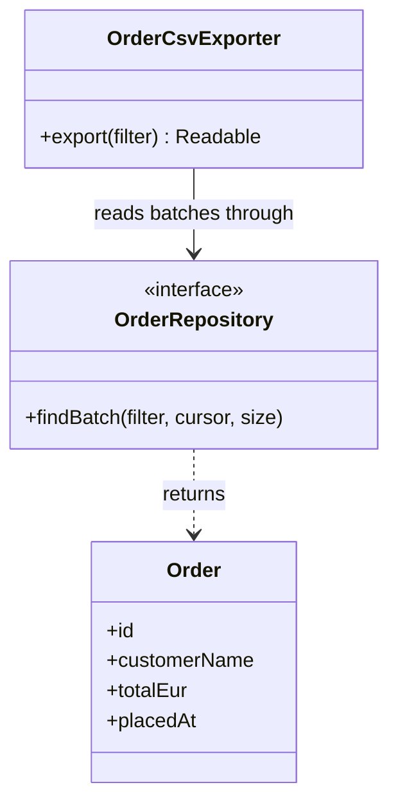
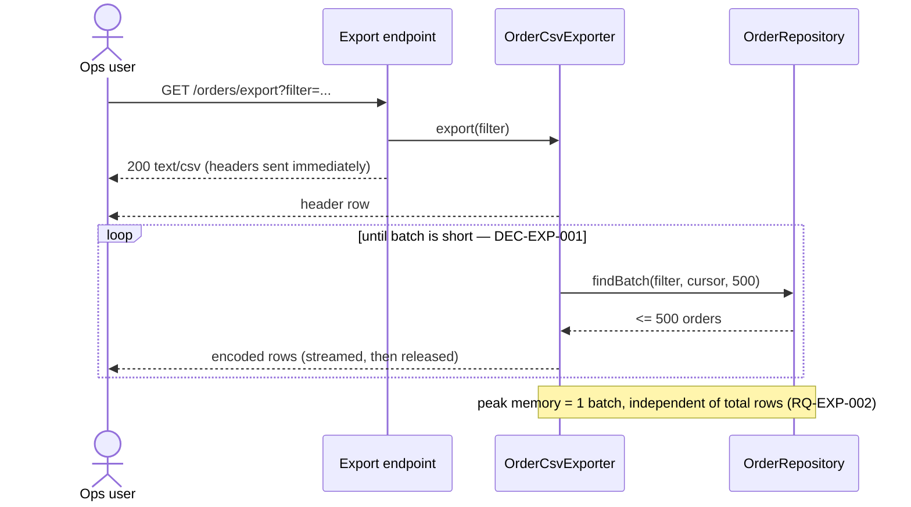

<!-- Written by agnos-init, do not edit: call agnos-init again to update. Your own notes belong in another file. -->
# Getting Started with AGNOS

AGNOS is now part of this project. This guide walks one complete session, start to finish, on one small feature, so
you can see what you type, what the agent produces, and how the pieces stay wired together.

> **Precedence.** This guide illustrates the process; it does not define it. The process is the `agnos-instructions` skill
> of the AGNOS plugin, and it is normative: where the two disagree, the skill wins. Each stage below names the
> section of the process it illustrates.

---

## Who does what

AGNOS is a two-role process. Knowing which role you are in at any moment is most of the skill.

| | You (human) | The agent |
|---|---|---|
| **Decides** | what to build, which trade-off wins, when a task is approved | how to implement an approved task |
| **Produces** | prompts, approvals, corrections | requirement files, ADRs, plans, code, commits |
| **Owns** | the *why* | the *how* |

You are not writing the artifacts. You are steering an agent that writes them, and reviewing what comes back. Most
of what follows is short prompts and short reviews.

---

## What `agnos-init` did

Calling the `agnos-init` skill wrote or changed these files, and left everything else in the project as it was:

| File | What it holds |
|---|---|
| `CLAUDE.md`, `AGENTS.md` | The same delimited AGNOS block, which tells the agent to load the process, the `agnos-instructions` skill. Your own text around it stays yours |
| `agnos-process/` | Four folders, `1.requirements/`, `2.architecture/`, `3.plan/` and `_sessionstate/`, each with a `readme.md` saying what it holds |
| `agnos-process/AGNOS-GETTING-STARTED.md` | This guide |
| `agnos-process/VERSION.txt` | The AGNOS version installed |
| `.gitignore` | A line ignoring `agnos-process/_sessionstate/session.yaml`, added only when git's rules do not ignore it yet |

Commit them when you are ready: AGNOS does not commit them for you, and its sessions never commit on your default
branch.

## The artifacts

Everything the agent writes for the process lives under `agnos-process/`, and every artifact has an identifier:

| Phase | Location | Artifacts | Format |
|---|---|---|---|
| Requirements | `agnos-process/1.requirements/` | `FTR-*` features, `RQ-*` requirements | EARS statements, Gherkin acceptance criteria |
| Architecture | `agnos-process/2.architecture/` | `ADR-*` records, `DEC-*` decisions | Context, Decision, Consequences, Alternatives, Mermaid diagrams |
| Planning | `agnos-process/3.plan/` | `PLAN-*` plans, `TASK-*` tasks | Tier, Gherkin criteria, Verification, Assumptions |
| Session state | `agnos-process/_sessionstate/` | `session.yaml`, `METRICS_LOG.md` | `session.yaml` is not version-controlled; `METRICS_LOG.md` is |

Every identifier follows `<TYPE>-<TRI>-<NNN>`, where `<TRI>` is a three-letter uppercase trigram for the functional area.
Identifiers appear as plain text in every related process document, and as comments in source files and tests; a commit message carries them in its subject.

## Two steps before the first session

1. **Open a new conversation in your tool** (Claude Code, GitHub Copilot…). The tool reads `CLAUDE.md` or
   `AGENTS.md` when a conversation opens, so the conversation in which `agnos-init` ran does not know the block yet.
2. **In that new conversation, ask for an AGNOS session**, as Stage 1 shows. A conversation is not a session: the
   agent starts one only when you ask. Run one session per conversation, and clear the conversation before the next one.

**Keep the process loaded.** The process is a skill: once invoked it lives only in the conversation, and the tool does
not reload it. A compaction can cut it (Claude Code keeps only the first 5,000 tokens of a skill after an automatic
compaction, and the process is longer) or drop it, with no warning. After any compaction, ask the agent to invoke
`agnos-instructions` again.

**Pick a trigram.** Three uppercase letters naming the functional area you are about to work on: `USR` for user
management, `EXP` for export, `PAY` for payments. It goes in every artifact ID, so pick one you can live with.

> The example below uses trigram **`EXP`**. It is fictional, reserved for this guide: do not use it for real work,
> so that searching for `EXP` never mixes this fiction with actual artifacts.

**Our example feature:** the operations team needs to download the order list as a CSV file. Some customers have
tens of thousands of orders.

---

## Stage 1 — Start the session

> Illustrates the process section **START SESSION ACTION**.

Sessions are the unit of work in AGNOS. Every session runs on its own branch and has its own recorded state.

**You type:**

```text
Start a new AGNOS session, trigram EXP.
```

**The agent then, without further prompting:**

1. Loads the process through the `agnos-instructions` skill, as the block orders, and reads any stack-specific
   instructions in the project, and `agnos-process/project-rules.md` if it exists (see Stage 9).
2. **Takes the trigram** from your prompt, or asks you for it, and **asks you a question**, with your tool's question
   feature:
   - *Should tests be generated and run in this session?* → `tests`
3. **Writes the session state** with the `agnos-session` skill's `init` sub-command: the skill detects `platform` itself,
   rewrites `agnos-process/_sessionstate/session.yaml` whole, and prints a summary table you can override. The agent
   never writes that file by hand.
4. **Rebuilds the index** with the `agnos-index` skill, which regenerates `agnos-process/process.idx.md`: one line per FTR,
   RQ, ADR, DEC, PLAN and TASK with its line range, status and title, plus a `#next` line giving the next free ID
   of each prefix. The agent reads this one small file, then opens documents only by line range, so it does not
   renumber over an existing `RQ-EXP-001` or duplicate an existing ADR. The index is generated by a script,
   versioned in git, and never edited by hand.
5. **Reports any conflict** it finds between its instruction files, and stops if it finds one.
6. **Creates the branch** with the `agnos-git-workflow` skill: `start-session EXP`. The skill checks that `EXP` is
   three uppercase letters *before* running any git command, then runs `git checkout -b feature/EXP`. If the branch
   already exists it asks you how to proceed rather than guessing.

**Result on disk — `agnos-process/_sessionstate/session.yaml`:**

```yaml
tri: EXP
tests: true
platform: windows
```

That file is the single source of truth for the whole session. Git does not commit it: `agnos-init` makes sure
`.gitignore` ignores it. It changes the agent's behaviour:

| Variable | Effect when set |
|---|---|
| `tests: false` | The agent skips the entire Testing section. No test files, no test runs. |
| `platform: windows` | Every shell command the agent generates is PowerShell. No `ls`, no `grep`. |

**Your job here:** check the summary table. If `tests` came back `true` but you are spiking a throwaway
prototype, say so now: changing it later means the session has been running under the wrong rules.

> **Never work on your default branch.** Every change in the session belongs on `feature/EXP`. If the agent is about
> to commit on `main`, stop it.

---

## Stage 2 — Author the requirement

> Illustrates the process section **1. REQUIREMENTS AUTHORING**.

You describe the need in your own words. The agent converts it to EARS and Gherkin. You review the conversion: this
is the stage where a vague sentence becomes a testable one, and it is worth your attention.

**You type:**

```text
New feature: the ops team must be able to download the order list as a CSV file.
Some customers have tens of thousands of orders, so it has to work on large lists
without the server falling over. Write the requirement.
```

**What comes back — `agnos-process/1.requirements/FTR-EXP-001.md`** (excerpt):

````markdown
# FTR-EXP-001: Order list CSV export

## Overview
Lets an operations user download the current order list as an RFC 4180 CSV file, for lists of any
size the system can hold.

## Stakeholders
- **Owner**: Operations Lead
- **Consumers**: Back-office web client; scheduled reporting jobs

---

## Functional Requirements

### RQ-EXP-001: Filtered order list CSV export
- **Category**: Functional
- **EARS Type**: Event-driven
- **Statement**: WHEN an authenticated operations user requests an export of the order list, the
  Order Service SHALL return an RFC 4180 CSV document containing one header row followed by one row
  per order matching the user's active filter.
- **Rationale**: The team reconciles orders in a spreadsheet; today they copy rows out of the web UI
  by hand.
- **Priority**: Must
- **Acceptance Criteria** (Gherkin):
  - **Given** an operations user whose filter matches 3 orders
  - **When** they request a CSV export
  - **Then** the response contains 1 header row and 3 data rows
  - **And** a field containing a comma or a quote is quoted per RFC 4180
- **Dependencies**: None

---

## Non-Functional Requirements

### RQ-EXP-002: Export peak memory
- **Category**: Non-Functional
- **NFR Type**: Performance
- **EARS Type**: State-driven
- **Statement**: WHILE an export is in progress, the Order Service SHALL keep resident memory
  attributable to that export below 50 MB regardless of the number of exported orders.
- **Metric**: Peak heap delta < 50 MB for an export of 1,000,000 orders
- **Measurement Method**: Node `process.memoryUsage().heapUsed` sampled every 100 ms during a
  1,000,000-order export in the load-test harness
- **Priority**: Must
- **Acceptance Criteria** (Gherkin):
  - **Given** a filter matching 1,000,000 orders
  - **When** the export runs to completion
  - **Then** peak heap delta stays below 50 MB
  - **And** the response completes without an out-of-memory error
- **Dependencies**: RQ-EXP-001
````

**Your job here — three things to check, every time:**

1. **Is it testable?** "has to work on large lists without falling over" is not. "< 50 MB peak heap for 1,000,000
   orders" is. If the agent produced an NFR with no number in it, send it back.
2. **Is the EARS type right?** An export triggered by a user action is *Event-driven* (`WHEN …`). A constraint that
   holds throughout an operation is *State-driven* (`WHILE …`). A rule that always holds is *Ubiquitous*. A guard
   against something going wrong is *Unwanted-behavior* (`IF … THEN …`).
3. **Did it invent scope?** If a requirement about Excel formats or email delivery appeared, you did not ask for it.
   Delete it.

**Correcting is normal and cheap:**

```text
RQ-EXP-002: 50 MB is too generous, our export pods are capped at 256 MB total.
Make it 20 MB and say it's measured on the load-test harness, not in production.
```

---

## Stage 3 — Record the architecture decision

> Illustrates the process section **2. ARCHITECTURE DECISIONS RECORDS (ADRs)**.

RQ-EXP-002 is the interesting one: it rules out the obvious implementation. Build the whole CSV in a string and
return it, and a million orders blow the memory budget. That is a real fork in the road, so it gets an ADR: a
written record of what was chosen and, just as importantly, what was rejected and why.

**You type:**

```text
RQ-EXP-002 rules out building the file in memory. Write the ADR for how we generate
the CSV. Consider streaming, a pre-generated file on object storage, and a background
job with a download link.
```

**What comes back — `agnos-process/2.architecture/ADR-EXP-001.md`** (excerpt):

````markdown
# ADR-EXP-001: CSV generation strategy for order export

## Status
Accepted

## Context
RQ-EXP-001 requires a CSV of the filtered order list; RQ-EXP-002 caps export-attributable memory at
20 MB for lists up to 1,000,000 rows. A row is ~120 bytes serialised, so a 1,000,000-row export is
~120 MB of CSV — six times the budget if the document is materialised before sending. The
repository already exposes cursor-based pagination over orders.

## Decision

### DEC-EXP-001: Streaming CSV generation
- **Statement**: The exporter SHALL stream the CSV document through a `Readable`, for memory independent of the result size.
- **Rationale**: A materialised 1,000,000-row CSV is about 120 MB, six times the RQ-EXP-002 budget; the repository already exposes cursor-based pagination, which a stream consumes batch by batch.

### DEC-EXP-002: Batched repository fetching
- **Statement**: The exporter SHALL fetch orders from the repository in batches of 500 rows.
- **Rationale**: 500 is the smallest batch that keeps the database round-trip count off the critical path at 1,000,000 rows; as a tuning knob it is a named constant, not a literal at a call site.

## Consequences

**Easier** — memory is flat in the number of rows; no storage bucket, no job queue, no new
infrastructure; the download starts immediately instead of after full generation.

**Harder** — the HTTP status is committed before the first row is read, so a database failure
mid-stream cannot become a clean `500`; the connection is torn down and the client sees a truncated
file. Accepted for an internal back-office tool. If exports later become customer-facing, revisit
via a superseding ADR.

**Constrained** — the exporter may never call an API that returns the full result set. Any future
column that needs a cross-row aggregate (a running total, say) breaks this decision and requires a
new ADR.

## Alternatives Considered

| Alternative | Why rejected |
|---|---|
| **Build the whole CSV in memory** | Simplest, and the error path is clean — a failure is still a plain `500`. Violates RQ-EXP-002 by ~6× at 1,000,000 rows. |
| **Pre-generate nightly to object storage** | Instant downloads, trivially cacheable. Rejected: the file is stale by up to 24 h and the team reconciles same-day orders, so it fails RQ-EXP-001's "current list". Adds a bucket and a lifecycle policy. |
| **Background job + emailed download link** | Handles unbounded sizes and survives client disconnects. Rejected as disproportionate: it adds a queue, a worker and a notification path for a report that streams in ~8 s. |

## Diagram




````

**Your job here:** read the **Alternatives Considered** table first, not the Decision. If a rejected option has no
honest upside listed, the agent has written an advocacy document rather than a decision record: send it back. The
rejected options are what makes the ADR useful in eight months, when someone asks "why didn't we just…".

Note `DEC-EXP-001` and `DEC-EXP-002`: decisions get their own IDs so code can cite the specific decision it
implements, not just the ADR as a whole. Each is a `### DEC-<TRI>-<NNN>: <title>` heading under `## Decision`, which
is what makes it appear in the index and in the traceability check of Stage 8.

---

## Stage 4 — Plan the work

> Illustrates the process section **3. PLAN - PLANNING AND EXECUTION**.

**You type:**

```text
Plan the implementation of FTR-EXP-001.
```

**What comes back — `agnos-process/3.plan/PLAN-EXP-001.md`** (excerpt):

````markdown
# PLAN-EXP-001: Order CSV export implementation

## Overview
Implements the streaming CSV exporter and exposes it on the orders API.

## References
- **Requirements**: RQ-EXP-001, RQ-EXP-002
- **ADRs**: ADR-EXP-001 (DEC-EXP-001, DEC-EXP-002)

---

## Tasks

### TASK-EXP-001: Implement streaming CSV exporter
- **Tier**: M
- **Status**: Not Started
- **Description**: Add `OrderCsvExporter`, which streams RFC 4180 CSV rows pulled from the order
  repository in bounded batches.
- **Requirement refs**: RQ-EXP-001, RQ-EXP-002
- **ADR refs**: ADR-EXP-001 (DEC-EXP-001, DEC-EXP-002)
- **Acceptance Criteria** (Gherkin):
  - **Given** a filter matching 3 orders
  - **When** `export(filter)` is consumed to the end
  - **Then** the stream emits 1 header row followed by 3 data rows
  - **And** a field containing a comma is wrapped in double quotes
  - **And** the repository is queried in batches of at most 500
- **Dependencies**: None
- **Assignee**: AI
- **Verification**: Not yet run — task not started
- **Assumptions**: None

### TASK-EXP-002: Expose GET /orders/export
- **Tier**: S
- **Status**: Not Started
- **Description**: Pipe the exporter's stream to the HTTP response with CSV download headers.
- **Requirement refs**: RQ-EXP-001
- **ADR refs**: ADR-EXP-001 (DEC-EXP-001)
- **Acceptance Criteria** (Gherkin):
  - **Given** an authenticated ops user
  - **When** they GET `/orders/export`
  - **Then** the response carries `Content-Type: text/csv`
  - **And** `Content-Disposition: attachment; filename="orders.csv"`
- **Dependencies**: TASK-EXP-001
- **Assignee**: AI
- **Verification**: Not yet run — task not started
- **Assumptions**: None
````

### The tier decides how much ceremony applies

| Tier | When | Tests | ADR | Written plan |
|---|---|:-:|:-:|:-:|
| **S** | ≤ 5 lines changed, no new file, no new public API | No | No | No |
| **M** | New method, class or file, contained to one module | Yes | No | Yes |
| **L** | Cross-cutting, new public API, or new dependency | Yes | Yes | Yes |

A Tier S task needs no written plan; it may still be listed in one, as TASK-EXP-002 is in PLAN-EXP-001 above.

When in doubt the agent defaults to **M**. A Tier S task that turns out to need a new file must be re-tiered before
it continues: that rule exists to stop "just a quick fix" from silently skipping tests.

### The agent stops here and waits

This is the **Definition of Ready** gate. Before any code is written, the agent presents the task and waits for your
explicit approval. You approve, or you redirect:

```text
TASK-EXP-001 approved. Skip TASK-EXP-002 for now — the endpoint needs an auth
decision we haven't made yet.
```

**Your job here:** this is the cheapest possible moment to change your mind. Read the acceptance criteria as the
contract they are: anything not written there will not be built.

---

## Stage 5 — Implement

> Illustrates the process section **4. CODE IMPLEMENTATION AND QUALITY**.

> **Test-first, in practice.** TASK-EXP-001 is Tier M, so the agent writes the Gherkin-named test of Stage 6
> *before* this implementation: a test written after the code risks describing what the code does instead of what it
> must do. The stages are shown implementation-first here for readability; the agent works in the reverse order.

**You type:**

```text
Implement TASK-EXP-001.
```

**What comes back — `src/export/orderCsvExporter.ts`:**

```typescript
// Implements: RQ-EXP-001 (CSV content), RQ-EXP-002 (bounded memory)
// Architecture: ADR-EXP-001 / DEC-EXP-001 (streaming CSV generation),
//               ADR-EXP-001 / DEC-EXP-002 (batched repository fetching)
// Task: TASK-EXP-001

import { Readable } from 'node:stream';
import type { Order, OrderFilter, OrderRepository } from './orderRepository';

/** Column order of the exported document — RQ-EXP-001. */
const CSV_COLUMNS = ['order_id', 'customer', 'total_eur', 'placed_at'] as const;

/** RFC 4180 encoding constants — RQ-EXP-001. */
const CSV_DELIMITER = ',';
const CSV_LINE_ENDING = '\r\n';
const CSV_QUOTE = '"';
const CSV_ESCAPED_QUOTE = '""';
const CSV_MUST_QUOTE = /[",\r\n]/;

/** Rows fetched per repository round-trip — ADR-EXP-001 / DEC-EXP-002. */
const FETCH_BATCH_SIZE = 500;

export class OrderCsvExporter {
  constructor(private readonly orders: OrderRepository) {}

  /**
   * Streams the filtered order list as RFC 4180 CSV.
   *
   * Peak memory is one batch, independent of result-set size — RQ-EXP-002.
   * The full result set is never materialised — ADR-EXP-001 / DEC-EXP-001.
   */
  export(filter: OrderFilter): Readable {
    const orders = this.orders;

    return Readable.from(
      (async function* generateRows() {
        yield CSV_COLUMNS.join(CSV_DELIMITER) + CSV_LINE_ENDING;

        let cursor: string | undefined;
        do {
          const batch = await orders.findBatch(filter, cursor, FETCH_BATCH_SIZE);
          for (const order of batch.items) {
            yield encodeRow(order);
          }
          cursor = batch.nextCursor;
        } while (cursor !== undefined);
      })(),
    );
  }
}

/** Encodes one order as an RFC 4180 record — RQ-EXP-001. */
function encodeRow(order: Order): string {
  const fields = [
    order.id,
    order.customerName,
    order.totalEur.toFixed(2),
    order.placedAt.toISOString(),
  ];
  return fields.map(encodeField).join(CSV_DELIMITER) + CSV_LINE_ENDING;
}

/** Quotes and escapes a field only when RFC 4180 requires it — RQ-EXP-001. */
function encodeField(value: string): string {
  if (!CSV_MUST_QUOTE.test(value)) {
    return value;
  }
  return CSV_QUOTE + value.split(CSV_QUOTE).join(CSV_ESCAPED_QUOTE) + CSV_QUOTE;
}
```

**What makes this AGNOS-conforming, and what you check in review:**

- **The header comment block.** Requirement IDs, ADR *and decision* IDs, task ID. This is the whole point: searching
  for `RQ-EXP-002` finds the requirement, the ADR, the plan, this file and its test. Traceability is always in
  **comments**, never in prose next to the code.
- **No magic literals.** `500` is `FETCH_BATCH_SIZE` and cites `DEC-EXP-002`. `','` is `CSV_DELIMITER`. Every
  constant is named and, where it comes from a decision, cites it. A raw `500` at the call site would fail the
  Definition of Done.
- **No scope creep.** No retry logic, no gzip, no logging, no progress events. None of that is in TASK-EXP-001's
  acceptance criteria. The process forbids "while I was in there" additions: they are unrequested, untested and
  untraceable.
- **SOLID.** The exporter depends on the `OrderRepository` interface, not a concrete database class, so the test
  below can drive it with an in-memory fake.

---

## Stage 6 — Test and verify

> Illustrates the process sections **4. Testing** and **Error Recovery Protocol**.

TASK-EXP-001 is Tier M, and `session.tests = true`, so tests are mandatory. Test names are written in Gherkin
and the requirement ID sits in a comment above each group, so the test suite doubles as the traceability report.

**What comes back — `tests/export/orderCsvExporter.spec.ts`:**

```typescript
// Verifies: RQ-EXP-001, RQ-EXP-002 — TASK-EXP-001

// RQ-EXP-001 — order list CSV export
describe('Order list CSV export', () => {
  it('Given a filter matching 3 orders, When the export is consumed, Then 1 header row and 3 data rows are emitted', async () => {
    const exporter = new OrderCsvExporter(fakeRepositoryWith(3));

    const rows = await collect(exporter.export(ANY_FILTER));

    expect(rows).toHaveLength(4);
    expect(rows[0]).toBe('order_id,customer,total_eur,placed_at');
  });

  it('Given a customer name containing a comma, When the export is consumed, Then the field is quoted', async () => {
    const exporter = new OrderCsvExporter(fakeRepositoryWithCustomer('Doe, John'));

    const rows = await collect(exporter.export(ANY_FILTER));

    expect(rows[1]).toContain('"Doe, John"');
  });
});

// RQ-EXP-002 — export peak memory
describe('Export peak memory', () => {
  it('Given 1200 matching orders, When the export is consumed, Then the repository is queried in batches of at most 500', async () => {
    const repository = recordingRepositoryWith(1200);

    await collect(new OrderCsvExporter(repository).export(ANY_FILTER));

    expect(repository.requestedBatchSizes).toEqual([500, 500, 500]);
  });
});
```

**You type:**

```text
Run the tests.
```

The agent runs the suite in the syntax of `session.platform`, PowerShell on Windows:

```powershell
npm test -- tests/export/orderCsvExporter.spec.ts
```

Its task's `Verification` field then states what ran, and how many tests were skipped and why: a skipped test is not
a passed test.

### When something fails

The **Error Recovery Protocol** is strict, and it is the rule most worth knowing as a reviewer:

1. Read the full error before acting.
2. Fix the **root cause**: never suppress, comment out, or skip the failing check.
3. **One** targeted fix, then re-run.
4. Still failing → **stop and report**. Do not guess twice.

So if you see the agent report a failure and hand control back to you instead of trying a third variation, that is
the process working, not the agent giving up.

The other rule that protects you: **a failing test is never edited to make it pass.** A test may only change if the
change reflects genuinely new or corrected expected behaviour, and then that belongs in the requirement first.

> **If `session.tests = false`,** this entire stage is skipped: no test files, no test run. Verification falls
> back to compiling and reviewing against the acceptance criteria. Everything else (traceability, named constants,
> the Definition of Done) still applies in full.

---

## Stage 7 — Commit the task

> Illustrates the process section **DEFINITION OF DONE - DoD**.

Before committing, the agent walks the Definition of Done for the task's tier:

| DoD item (Tier M) | TASK-EXP-001 |
|---|---|
| Every new artifact references a requirement ID | ✓ header comments in source and test |
| No duplicated inline literal — all named constants | ✓ `FETCH_BATCH_SIZE`, `CSV_DELIMITER`, … |
| No failing test was modified to force a pass | ✓ suite green on first run |
| UI change consumes design-system tokens | n/a — no UI |
| Compiles and passes static analysis | ✓ `tsc --noEmit`, `eslint` clean |

Then it commits through the `agnos-git-workflow` skill rather than raw git, so the message format is mechanical
rather than remembered:

```text
commit-task TASK-EXP-001 ADR-EXP-001 add streaming CSV order exporter
```

The skill checks the format of `TASK-EXP-001` and `ADR-EXP-001` **before** touching git, then refreshes
`agnos-process/process.idx.md` with the `agnos-index` skill, refusing to commit if two artifacts share an ID. It infers a
Conventional-Commits `<type>` from the nature of the change, builds the message, shows it to you for confirmation,
then runs `git add .` and `git commit`.

**Resulting commit message:**

```text
feat(EXP): ADR-EXP-001/TASK-EXP-001 add streaming CSV order exporter

Co-Authored-By: Claude Code/Claude Opus 5.5 <noreply@anthropic.com>
```

Without an ADR it would be `feat(EXP): TASK-EXP-002 expose GET /orders/export`. The `<type>` is inferred by the
agent (`feat`, `fix`, `docs`, `refactor`, `test`, ...): you are only asked if it is genuinely ambiguous.

> **`git add .` stages everything in the working tree that git does not ignore.** If you have unrelated work in
> progress, commit or stash it before a task commit, or it lands under this task's ID. Generated files, such as
> Python's `__pycache__/` or a build folder, belong in your `.gitignore`: AGNOS leaves that file to you.

The chain is now closed. From the commit message you reach the task, from the task the ADR and the requirement, from
the requirement the feature, and searching for `RQ-EXP-001` returns every one of them plus the code and the tests.

---

## Stage 8 — Check the traceability

> Illustrates the process section **MANDATORY TRACEABILITY**, checked by the `agnos-perf-center` skill.

A search answers one ID at a time. Before closing a session, or before a release, you want the whole picture: which
requirements are implemented, which are not, and what is linked to nothing. The `agnos-perf-center` skill builds it.

**You type:**

```text
Generate the traceability matrix for src and tests.
```

**The agent** invokes the `agnos-perf-center` skill on the `src` and `tests` folders, then reports, before its result line,
the `scanned extensions`, `scanned names` and `excluded` lines, each saying whether it is the default or the user's list.
The result line follows as it is:

```text
agnos-perf-center: 9 elements, 2 files; RQ 2: covered 2, indirect 0, uncovered 0; quality: <grade> <score>/10;
checks: covered <s>, defined <s>, tasked <s>, task-rq <s>, adr-rq <s>, filled <s>, connected <s>,
files-traced <s>; findings 0; agnos-process/PERF-CENTER.html written in <s.mmm> s
```

**What you get — `agnos-process/PERF-CENTER.html`**, a complete application. Open it from disk in any current browser; it
loads its libraries from cdnjs, so it needs the network once. Keep `PERF-CENTER.data.js` beside it;
`PERF-CENTER.json` holds the same data for any other tool. The three files are generated: whether you commit them
or ignore them is your choice.

| View | What it answers |
|---|---|
| **Overview** | How much is covered? Element counts, share of requirements covered / indirectly covered / uncovered, the quality score and grade, coverage per trigram. |
| **Graph** | How is this element wired? The selected element's links as columns — features, requirements, ADRs and decisions, plans and tasks, source files — at depth 1 to 3. |
| **Matrix** | One row per requirement with its feature, ADRs, decisions, tasks, source files and lines, and coverage — sortable, searchable, exportable as CSV. |
| **Quality** | How good is the traceability? A report card with a grade from A to E, the checks behind the score, each with its findings, and charts per feature area. Each finding links to its element. |
| **Detail panel** | Everything about the selection: type, title, status, location, links grouped by type. |

**Down to the functions — `--call-graph`.** Ask for it and the functions of the scanned files become elements too: a
requirement's panel lists the functions that cite it; a function's panel lists its callers, its callees and the IDs
it cites; the graph's **Implementation** switch draws them at the level of the function, the class or the namespace.
Supported languages: C, C++, C#, Java, JavaScript / Node.js, Python and Rust — not TypeScript, so this guide's
example would get no functions. The option needs the tree-sitter packages; the agent installs them once, with your
approval, from the `agnos-perf-center` skill's `requirements-callgraph.txt`. Without them the page is written all the
same, without functions.

**Who changed what — `--history`.** Ask for it and the page reads the project's git log: its **History** view shows
who, humans and agents, changed each requirement and its code, and its **Delivery** view shows what was delivered and
when. `--history-since` and `--history-depth` limit what is read.

**Your job here — read the findings, every non-zero one is a defect to fix or to justify:**

| Finding | Meaning | Typical fix |
|---|---|---|
| `uncovered` | No source file cites the requirement, directly or through its task, ADR or decision | Implement it, or cite the ID where it is implemented |
| `untasked` | No task cites the requirement | Plan it |
| `task-no-rq` / `adr-no-rq` | A task or ADR cites no requirement | Add the requirement ref |
| `empty` | Feature without requirement, ADR without decision, plan without task | Complete or remove it |
| `isolated` | Nothing links to the element | Link it, or delete it |
| `undefined` | An ID is cited but defined nowhere | Fix the typo, or write the missing artifact |
| `untraced-files` | A scanned file cites no ID | Add the header comment |

Coverage is file-based: **covered** means a source file cites the requirement itself; **indirect** means it cites
only a linked task, decision, ADR or feature.

> Give `--sources` the folders that should carry IDs: code, tests, build files, CI. Never a documentation folder, nor
> the project's root, whose `agnos-process/` holds this guide: its example IDs would show up as `undefined`.

---

## Stage 9 — Close the session

> Illustrates the process section **END SESSION ACTION**.

**You type:**

```text
End of session.
```

**What comes back — in chat, not as a file:**

```text
Session summary — feature/EXP

Requirements addressed
  RQ-EXP-001  Filtered order list CSV export         — implemented, verified
  RQ-EXP-002  Export peak memory                     — implemented, verified (batch-size test)

ADRs
  ADR-EXP-001  CSV generation strategy for order export  (Accepted)
               DEC-EXP-001 Streaming CSV generation
               DEC-EXP-002 Batched repository fetching

Tasks completed
  TASK-EXP-001  Implement streaming CSV exporter  Tier M  Done
  TASK-EXP-002  Expose GET /orders/export       Tier S  Not started — deferred by user

Blockers
  TASK-EXP-002 deferred: the endpoint needs an authorisation decision that is out of
  scope for FTR-EXP-001. Carry into the next session; consider an ADR for the
  back-office authorisation model.

Process friction metrics
  AskUserQuestion            0
  Error Recovery Protocol    0
  Tasks re-tiered            0
  Verification catches       0
```

**Your job here:** the summary is a hand-off note to your future self. Check that deferred work is named with its ID
and its reason: that is what the next session picks up.

The agent passes the four counters to the `agnos-session` skill's `close` sub-command, which appends one row to
`agnos-process/_sessionstate/METRICS_LOG.md`, created with its header by the first session to close. The agent never
writes that row itself. Every counter is shown even at 0.

**Improving the process for this project.** Had a counter come back non-zero, the agent would propose a follow-up
through the `agnos-self-improvement` skill: it asks how many lines it may add, proposes one to three themes,
and waits for your confirmation before drafting anything. The rules it adds go into `agnos-process/project-rules.md`, which the AGNOS block of `CLAUDE.md` and `AGENTS.md`
names: the agent reads that file in every conversation, and an update of the plugin never touches it. It never edits
the plugin's own files.

**Then a context reset.** Once the summary, the metrics and any follow-up are done and no task remains, the agent tells
you to run the context-reset command of your tool: `/clear` on Claude Code and GitHub Copilot.

> **Long sessions:** past about ten tasks, or when replies start losing earlier context, the agent writes a checkpoint
> to `agnos-process/3.plan/` (completed IDs, open IDs, blockers, key decisions) and suggests starting fresh. Do not push
> through a saturated session: take the checkpoint.

---

## What you actually type, all together

One row per stage. This is the whole human side of a session.

| Stage | You type | You get back |
|---|---|---|
| 1. Start | `Start a new AGNOS session, trigram EXP.` | 1 question, `session.yaml`, index, branch `feature/EXP` |
| 2. Requirement | `New feature: <description in plain words>. Write the requirement.` | `FTR-EXP-001.md` — EARS + Gherkin |
| 3. ADR | `<RQ-ID> rules out <X>. Write the ADR. Consider <options>.` | `ADR-EXP-001.md` — decisions + alternatives + diagram |
| 4. Plan | `Plan the implementation of FTR-EXP-001.` | `PLAN-EXP-001.md`, then a **wait** for your approval |
| 5. Implement | `TASK-EXP-001 approved. Implement it.` | Source with ID comments, named constants |
| 6. Test | `Run the tests.` | Gherkin-named tests, run under `session.platform` |
| 7. Commit | *(agent proposes)* `commit-task TASK-EXP-001 ADR-EXP-001 <description>` | `feat(EXP): ADR-EXP-001/TASK-EXP-001 <description>` |
| 8. Perf Center | `Generate the AGNOS Performance Center for src and tests.` — options: `--call-graph` (functions and calls), `--history` (who changed what, deliveries; `--history-since 6.months`) | `PERF-CENTER.html` — Performance Center: matrix, coverage, quality score and grade, graph; call graph and history with their options |
| 9. Close | `End of session.` | Summary report with deferred work, blockers and friction metrics, then a reminder to run `/clear` |

Corrections at any point are just sentences: *"RQ-EXP-002 should be 20 MB, not 50."* — *"Drop the retry logic, it's
not in the acceptance criteria."* — *"Re-tier that as M, it needs a new file."*

---

## If your project has a user interface

One rule changes the running order, and it is non-negotiable: **a project with a UI defines its design system before
implementing its first UI requirement.** A single machine-readable source of truth for colours, spacing, typography,
strokes and component metrics, consumable from code as tokens.

Concretely, before Stage 5 on any UI work:

1. The design system gets **its own requirement and its own ADR**, with normal IDs, so it is referenceable like
   anything else. Ask the agent to *create the design system*: it invokes the `agnos-design-system` skill, which
   copies its template into `agnos-process/1.requirements/`, assigns the IDs and drafts the ADR.
2. Every UI requirement, ADR and task lists those design-system IDs in its **Dependencies** / **refs** fields.
3. UI code initialises every visual constant from a token. A local named constant may *alias* a token for
   readability, but must never hold a raw visual value.
4. A value taken from a mockup that deviates from the reference is recorded **in the design system** with a
   rationale note, never inlined in code as a literal.

A UI artifact that bypasses the design system is incomplete and is not delivered, exactly like an artifact with no
requirement ID.

---

## Mistakes that cost the most

| Mistake | What it breaks | Do instead |
|---|---|---|
| Asking for a session in the conversation where `agnos-init` ran | The agent has not read the block yet | Open a new conversation first |
| Going on after a compaction without invoking the process again | The end of the process may be cut: tests, anti-patterns, Error Recovery Protocol | Ask the agent to invoke `agnos-instructions` again |
| Skipping the requirement and prompting straight for code | Nothing to trace to; the DoD cannot be satisfied | Spend two minutes on the requirement: the agent writes it, you review it |
| Accepting an NFR with no number in it | Unverifiable; nobody can tell when it is met | Demand a metric and a measurement method |
| Approving a task without reading the acceptance criteria | You get exactly what is written there, and nothing else | Read the Gherkin as the contract it is |
| Letting a "quick fix" stay Tier S after it grows a new file | Silently skips the test obligation | Re-tier to M and let the tests be written |
| Uncommitted unrelated work, or generated files not ignored, at commit time | `git add .` sweeps them into the task commit | Commit or stash first; list generated files in `.gitignore` |
| Working on `main` | Loses the session's isolation and its history | Every change on `feature/<TRI>` |
| Letting the agent retry a failing fix repeatedly | Buries the root cause under workarounds | The protocol allows one attempt, then a stop and a report |
| Editing this guide or the AGNOS block | The next `agnos-init` overwrites it | Write your own rules in `agnos-process/project-rules.md` |

---

## Where to go next

Ask the agent: it reads the skills of the AGNOS plugin, which the tool lists.

| Skill | What it is for |
|---|---|
| `agnos-instructions` | The rules themselves, normative: ID schema, templates, tiers, Definition of Done, session variables |
| `agnos-init` | Adds AGNOS to a project; call it again after an update of the plugin, to refresh the block and this guide |
| `agnos-session` | Writes the session state at session start, reloads it, and appends the session's friction-metrics row at close |
| `agnos-index` | Regenerates `agnos-process/process.idx.md` |
| `agnos-git-workflow` | The session branch and the task commits |
| `agnos-design-system` | The design system of a project with a user interface |
| `agnos-perf-center` | The traceability check and its page |
| `agnos-self-improvement` | Runs a recursive self-improvement effort on the improvement target the project declares, within its line budget |
