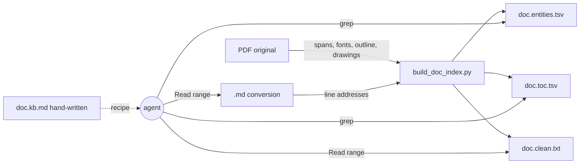
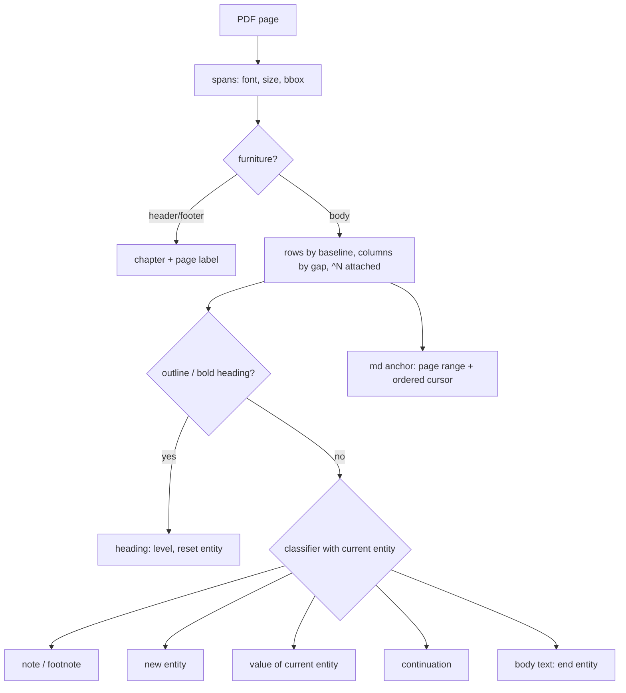
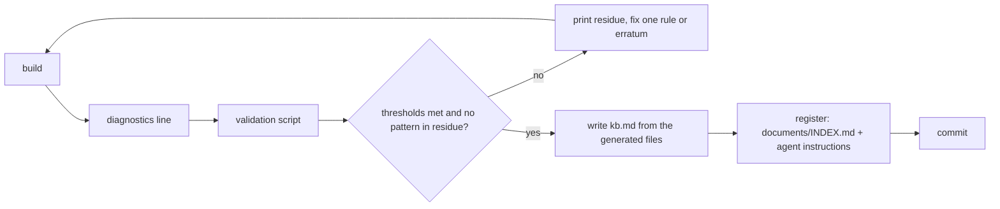

# Indexing a PDF and its Markdown conversion — guide for agentic AIs

<!-- FTR-DIX-001, ADR-DIX-001 to ADR-DIX-003 -->

This guide tells an AI coding agent how to build, for any PDF document and the Markdown file converted from it, a
**machine index** that later lets an agent answer a question about the document with one `grep` and one ranged `Read`,
instead of reading hundreds of pages. It is generic: the requirements (FTR-DIX-001) and the architecture (ADR-DIX-001 to
ADR-DIX-003) hold for any document; the playbook (last part) says how to apply them to a new one.

Two builders in this directory implement it and are the reference implementations:

| builder | document | entities | outputs |
|---|---|---|---|
| `build_sysex_index.py` | SysEx spec, 46 pages, made of tables | one row per table item, with footnotes | `sysex_spec.clean.txt`, `sysex_spec.items.tsv`, `sysex_spec.kb.md` |
| `build_manual_index.py` | operator's manual, 292 pages, prose and definition lists | parameters, values, notes, footnotes, back-of-book index entries | `user_manual.clean.txt`, `user_manual.toc.tsv`, `user_manual.terms.tsv`, `user_manual.kb.md` |

Start a new builder from the closer of the two (tables → the first, prose with headings → the second).

## Domain of validity
The guide was derived from these two documents only, both from one publisher (Akai, 1999-2001) and probably converted
to Markdown by one tool; it has not been tried on a third document. It assumes:
1. **The `.md` keeps the PDF's line order**, one PDF line per `.md` line (a text-layer extraction). A converter that
   reflows paragraphs or rebuilds tables (Marker, Pandoc, Docling…) breaks the anchoring of DEC-DIX-009; RQ-DIX-003 and
   RQ-DIX-017 then need another scheme, not given here.
2. **Pages are recognisable in the `.md`** by a repeated running header or footer (RQ-DIX-003). Without one, the page
   ranges must come from another marker, not given here.
3. **The PDF is born digital** (an extractable text layer; no OCR) **with a single column of body text**. Two columns of
   running text (articles, datasheets) need a column split before the rows of DEC-DIX-006.
4. **The thresholds of DEC-DIX-006 and DEC-DIX-009** (2 pt, 12 pt, 20 characters) fit 10 pt body text and are starting
   values to measure (DEC-DIX-005).
5. **Latin script**: the reference key keeps ASCII letters and digits only (DEC-DIX-009).
6. **Optional structures**: the outline, NOTE/TIP boxes, footnotes numbered through the document and a two-column
   back-of-book index were all present in the references; RQ-DIX-005, RQ-DIX-009 and RQ-DIX-010 apply only where they
   exist, and their rules have not met a document that lacks them.
7. **The thresholds of the non-functional requirements** (RQ-DIX-016 to RQ-DIX-022) are calibrated on the two references:
   the results measured on them, rounded down. A document whose layout defeats them reports the measured value and its
   cause in its knowledge base rather than lowering the threshold silently.

A new document that breaks one of these assumptions is the test of the guide: record what had to change, in the guide
itself, with the document that showed it.

The requirements and ADRs below use the AGNOS structure (`.github/instructions/agnos-sw-eng.instructions.md`, §1 Requirement File Template and §2 ADR structure), at the same heading levels, so that each block can be copied as is.
They live here, not in `process/`, because they describe a reusable tool pattern, not a feature of this project; a project
that adopts the pattern as a feature copies them into its own `process/` and renumbers them there.

---

# FTR-DIX-001: PDF + Markdown Document Index

## Overview
For one source document available both as a PDF (the original, faithful layout) and as a Markdown conversion (searchable
text, one PDF line per Markdown line, layout lost), a builder script regenerates a set of files that locate every unit of
meaning of the document (heading, table item, parameter, note, footnote, index entry) by PDF page, printed page, Markdown
line and clean-text line, plus a hand-written knowledge base that explains how to query them. Out of scope: images and
screenshots inside the PDF, OCR of scanned PDFs, full-text search engines.

## Stakeholders
- **Owner**: the repository owner who adds the document.
- **Consumers**: AI agents answering questions about the document; humans reading the knowledge base; the project's agent
  instructions file, which points agents at the index.

---

## Functional Requirements

### RQ-DIX-001: Source pair and outputs
- **Category**: Functional
- **EARS Type**: Ubiquitous
- **Statement**: The index builder SHALL read one PDF and its Markdown conversion and SHALL write, in `documents/_index/`
  under one prefix `<doc>`, the generated files `<doc>.clean.txt`, `<doc>.<entities>.tsv` and, when the document has
  headings, `<doc>.toc.tsv`.
- **Rationale**: one predictable set of files per document lets an agent find the index without being told its layout.
- **Priority**: Must
- **Acceptance Criteria**: Given a PDF and its `.md` in `documents/`, When `python documents/_index/build_<doc>_index.py` runs
  from the repository root, Then the three files exist under `documents/_index/` with the `<doc>` prefix.
- **Dependencies**: DEC-DIX-001, DEC-DIX-002, DEC-DIX-004

### RQ-DIX-002: Printed page labels
- **Category**: Functional
- **EARS Type**: Ubiquitous
- **Statement**: The index builder SHALL give every PDF page its printed page label (number or roman numeral), read from
  the page's own footer or header text, and an empty label to a page that prints none.
- **Rationale**: humans and the document itself cite printed pages, which differ from PDF page numbers.
- **Priority**: Must
- **Acceptance Criteria**: Given a page whose footer prints "91", When the index is built, Then every row of that page has
  `doc` = 91; Given the cover, Then its `doc` is empty. A fixed offset (printed = pdf − k) MAY replace the footer reading
  only when the builder's run verified it on every numbered page.
- **Dependencies**: DEC-DIX-003

### RQ-DIX-003: Markdown page ranges
- **Category**: Functional
- **EARS Type**: Ubiquitous
- **Statement**: The index builder SHALL give every PDF page the first and last line of its text in the `.md`, derived from
  the page markers of the `.md` (footer lines, running headers after a blank line) matched in order with the PDF pages
  that carry the same marker.
- **Rationale**: an agent reads the `.md` by line range; the conversion has no explicit page breaks.
- **Priority**: Must
- **Acceptance Criteria**: Given the `.md` range a–b of PDF page N, When lines a–b are read, Then they start with page N's
  running header (or first line) and end before page N+1's.
- **Dependencies**: RQ-DIX-002, DEC-DIX-009

### RQ-DIX-004: Layout-faithful clean text
- **Category**: Functional
- **EARS Type**: Ubiquitous
- **Statement**: The index builder SHALL write the whole text of the PDF, page by page, one visual row per line, with the
  columns of a row joined by ` | `, the running header and footer removed, and each page preceded by the banner
  `=== pdf p<N> | doc p<label> | md L<a>-<b> | <chapter or table> ===`.
- **Rationale**: tables and two-column layouts are broken in the `.md`; the clean text keeps them readable and grep-able.
- **Priority**: Must
- **Acceptance Criteria**: Given a table row "&21 | 0–100 | Set Cutoff" in the PDF, When the clean text is built, Then one
  line holds the three cells separated by ` | `, under the banner of its page.
- **Dependencies**: DEC-DIX-006

### RQ-DIX-005: Headings
- **Category**: Functional
- **EARS Type**: Ubiquitous
- **Statement**: The index builder SHALL mark each heading in the clean text with `#` repeated by its level, taking the
  headings and levels from the PDF outline (bookmarks) when it has one and adding the typographic headings (bold, larger
  size, heading column) that the outline lacks.
- **Rationale**: the outline is the author's own structure; typography fills its gaps.
- **Priority**: Must
- **Acceptance Criteria**: Given an outline of N entries, When the index is built, Then the diagnostics report 0 outline
  entries not placed, and a bold heading absent from the outline appears as a heading of the level its typography gives.
- **Dependencies**: DEC-DIX-007

### RQ-DIX-006: Table of contents
- **Category**: Functional
- **EARS Type**: Ubiquitous
- **Statement**: Where the document has headings, the index builder SHALL write one TSV row per heading with its level,
  title, path (`chapter > section > …`), and the PDF page, printed page, `.md` line and clean line spans of its section,
  a section ending before the next heading of the same or a higher level.
- **Rationale**: the span lets an agent read exactly one section.
- **Priority**: Must
- **Acceptance Criteria**: Given the row of section S with `md` = a-b, When lines a-b are read, Then they hold S's heading
  first and stop before the next heading of S's level or higher.
- **Dependencies**: RQ-DIX-003, RQ-DIX-005

### RQ-DIX-007: Entity rows
- **Category**: Functional
- **EARS Type**: Ubiquitous
- **Statement**: The index builder SHALL write one TSV row per unit of meaning of the document, with a `kind` column, the
  entity's name, its parent entity, its description, its enclosing section or table group, and the four locators `pdf`,
  `doc`, `md`, `clean`.
- **Rationale**: the units of meaning (a SysEx item, a parameter, a value) are what agents look up.
- **Priority**: Must
- **Acceptance Criteria**: Given a parameter "RATE" defined under "LFO 2", When `grep RATE <doc>.<entities>.tsv` runs, Then a
  row of its kind gives section "LFO 2" and the `md` line that starts with "RATE".
- **Dependencies**: DEC-DIX-003, DEC-DIX-008

### RQ-DIX-008: Entity continuation
- **Category**: Functional
- **EARS Type**: Event-driven
- **Statement**: WHEN a row is aligned with the description column of the current entity, on the same page or at the top
  of the next one, the index builder SHALL append the row to that entity's description, rejoining a word broken by a
  hyphen at the end of the previous line.
- **Rationale**: descriptions span lines and pages; a row per line would split one definition.
- **Priority**: Must
- **Acceptance Criteria**: Given a description that ends a page with "be-" and goes on with "low the note" on the next page,
  When the index is built, Then the entity's description holds "below the note" once.
- **Dependencies**: DEC-DIX-008

### RQ-DIX-009: Notes and footnotes
- **Category**: Functional
- **EARS Type**: Event-driven
- **Statement**: WHEN the document has notes (NOTE/TIP boxes) or footnotes, the index builder SHALL write one entity row
  per note and per footnote, and SHALL keep each footnote reference in the clean text attached to its word (`^N`) or, for a
  table, in the item's footnote column.
- **Rationale**: notes and footnotes carry limits and exceptions that agents need.
- **Priority**: Should
- **Acceptance Criteria**: Given footnotes numbered 1 to 20, When the index is built, Then 20 footnote rows exist and the
  diagnostics count 20.
- **Dependencies**: DEC-DIX-006, DEC-DIX-008

### RQ-DIX-010: Back-of-book index
- **Category**: Functional
- **EARS Type**: Event-driven
- **Statement**: WHEN the document ends with an alphabetical index, the index builder SHALL write one entity row per
  (index term, cited page), anchored at the first line that names the term on that page, else on the next or the
  previous page, else at the page's banner.
- **Rationale**: the author's index maps vocabulary to pages that a plain grep misses.
- **Priority**: Should
- **Acceptance Criteria**: Given "Goto Dest 85, 91, 94, 122", When the index is built, Then four rows exist, one per page.
- **Dependencies**: RQ-DIX-002, RQ-DIX-018

### RQ-DIX-011: Graceful degradation
- **Category**: Functional
- **EARS Type**: Unwanted-behavior
- **Statement**: IF a row has no matching `.md` line or an outline entry has no matching row, THEN the index builder SHALL
  anchor the row at the current `.md` cursor or place the heading at the top of its page, count the case in its
  diagnostics, and go on.
- **Rationale**: one odd line must not stop the build or shift every later anchor.
- **Priority**: Must
- **Acceptance Criteria**: Given a PDF line absent from the `.md`, When the index is built, Then the build ends with exit
  code 0 and the diagnostics report the unanchored count.
- **Dependencies**: RQ-DIX-013

### RQ-DIX-012: Source errata
- **Category**: Functional
- **EARS Type**: Unwanted-behavior
- **Statement**: IF the document contradicts itself and the contradiction is established from the document alone, THEN
  the index builder SHALL correct the generated value through a named exception commented with the page that proves it,
  and the knowledge base SHALL list the erratum.
- **Rationale**: a copied error propagates into code; a silent fix hides it.
- **Priority**: Should
- **Acceptance Criteria**: Given a table titled with section &14 whose items belong to &16, When the index is built, Then
  its rows carry &16 and the knowledge base's errata section names the table and the page.
- **Dependencies**: DEC-DIX-011

### RQ-DIX-013: Diagnostics
- **Category**: Functional
- **EARS Type**: Event-driven
- **Statement**: WHEN a build ends, the index builder SHALL print one line giving the count of headings and of each entity
  kind, the rows anchored in the `.md` out of all rows, and the outline entries not placed.
- **Rationale**: the counts are the regression check of a heuristic extractor.
- **Priority**: Must
- **Acceptance Criteria**: Given a build, When it ends, Then its last output line holds these counts.
- **Dependencies**: DEC-DIX-010

### RQ-DIX-014: Knowledge base
- **Category**: Functional
- **EARS Type**: Ubiquitous
- **Statement**: The index SHALL include a hand-written `<doc>.kb.md` giving the lookup recipe (which file to grep, its
  columns and kinds, how to read a range), the page numbering, a topic → page / `.md` line map, the document's errata,
  and facts each cited with its page, an inference of the author's own marked `[?]`.
- **Rationale**: the recipe is what makes the generated files usable at the first query.
- **Priority**: Must
- **Acceptance Criteria**: Given the knowledge base, When an agent follows its recipe for a named entity, Then it reaches the
  entity's text with one grep and one ranged Read.
- **Dependencies**: DEC-DIX-012

### RQ-DIX-015: Registration
- **Category**: Functional
- **EARS Type**: Event-driven
- **Statement**: WHEN an index is added, the agent SHALL list its files in `documents/INDEX.md` and add to the project's
  agent instructions one sentence that sends any search in the document to its knowledge base.
- **Rationale**: an index no agent is told about is never used.
- **Priority**: Must
- **Acceptance Criteria**: Given a new index, When `documents/INDEX.md` and the agent instructions are read, Then both name
  `<doc>.kb.md`.
- **Dependencies**: RQ-DIX-014

---

## Non-Functional Requirements

<!-- Thresholds calibrated on the two reference documents only: see Domain of validity, item 7. -->

### RQ-DIX-016: Build time
- **Category**: Non-Functional
- **NFR Type**: Performance
- **EARS Type**: Ubiquitous
- **Statement**: The index builder SHALL rebuild all its files in at most 5 s for a 300-page PDF.
- **Metric**: wall-clock time of one run ≤ 5 s (observed: 0.98 s for 292 pages). Calibrated on the two reference documents (Domain of validity, item 7).
- **Measurement Method**: `time python documents/_index/build_<doc>_index.py` on the developer's machine, at each change.
- **Priority**: Should
- **Acceptance Criteria**: Given a 300-page PDF, When the builder runs, Then it ends within 5 s.
- **Dependencies**: DEC-DIX-006

### RQ-DIX-017: Anchor precision
- **Category**: Non-Functional
- **NFR Type**: Reliability
- **EARS Type**: Ubiquitous
- **Statement**: The index builder SHALL anchor at least 98 % of the clean rows in the `.md`, and every named entity row
  SHALL point at a `.md` line and a clean line that start with the entity's name.
- **Metric**: anchored rows / rows ≥ 0.98 (observed 0.994); entity rows whose `md` and `clean` lines start with the name =
  100 %. Calibrated on the two reference documents (Domain of validity, item 7).
- **Measurement Method**: the diagnostics line, and the validation script of the playbook, step 7, before the index is committed.
- **Priority**: Must
- **Acceptance Criteria**: Given a build, When the validation script runs, Then it reports 100 % for every named kind.
- **Dependencies**: DEC-DIX-009, DEC-DIX-010

### RQ-DIX-018: Back-of-book index precision
- **Category**: Non-Functional
- **NFR Type**: Reliability
- **EARS Type**: Ubiquitous
- **Statement**: The index builder SHALL anchor at least 85 % of the back-of-book index rows on a line naming the term, and
  every such row on its cited page or the page next to it.
- **Metric**: rows not anchored on their page banner / rows ≥ 0.85 (observed 0.90). Calibrated on the two reference documents (Domain of validity, item 7).
- **Measurement Method**: count the `I` rows whose clean line is a banner (playbook, step 7).
- **Priority**: Should
- **Acceptance Criteria**: Given a build, When the count runs, Then at most 15 % of the rows point at a banner.
- **Dependencies**: RQ-DIX-010

### RQ-DIX-019: Reproducible output
- **Category**: Non-Functional
- **NFR Type**: Reliability
- **EARS Type**: Ubiquitous
- **Statement**: The index builder SHALL write UTF-8 files with LF line endings, byte-identical from one run to the next on
  the same inputs, on every platform.
- **Metric**: `git status` clean after a second run; `git ls-files --eol` shows `lf` for every generated file.
- **Measurement Method**: run twice, then `git status` and `git ls-files --eol documents/_index`.
- **Priority**: Must
- **Acceptance Criteria**: Given a committed index, When the builder runs again on Windows, Then git reports no change.
- **Dependencies**: DEC-DIX-004

### RQ-DIX-020: Portability
- **Category**: Non-Functional
- **NFR Type**: Portability
- **EARS Type**: Ubiquitous
- **Statement**: The index builder SHALL run from the repository root with Python 3.10 or later and PyMuPDF as its only
  third-party package, offline, on Windows, Linux and macOS.
- **Metric**: one import outside the standard library (`pymupdf`); no network access.
- **Measurement Method**: read the imports; run on the session's platform.
- **Priority**: Must
- **Acceptance Criteria**: Given a machine with Python and `pip install pymupdf`, When the builder runs, Then it succeeds.
- **Dependencies**: DEC-DIX-004

### RQ-DIX-021: Maintainable builder
- **Category**: Non-Functional
- **NFR Type**: Maintainability
- **EARS Type**: Ubiquitous
- **Statement**: The index builder SHALL be one script of at most 500 lines whose geometric and typographic thresholds are
  named constants commented with what they measure, with no function above a cognitive complexity of 15 and no static
  analysis finding; its header SHALL list what it reads, writes, needs and how it runs.
- **Metric**: line count ≤ 500 (calibrated: the reference builders have 294 and 474 lines); 0 findings of the IDE's static analysis
  (SonarQube for IDE here).
- **Measurement Method**: `wc -l`; the IDE's diagnostics of the file.
- **Priority**: Should
- **Acceptance Criteria**: Given the builder, When the IDE analyses it, Then it reports no finding.
- **Dependencies**: DEC-DIX-005

### RQ-DIX-022: Lookup cost
- **Category**: Non-Functional
- **NFR Type**: Usability
- **EARS Type**: Ubiquitous
- **Statement**: The index SHALL let an agent reach the text of any named entity or section with at most one grep and one
  ranged Read, and its knowledge base SHALL stay under 250 lines.
- **Metric**: tool calls per lookup ≤ 2; `wc -l <doc>.kb.md` < 250. Calibrated on the two reference documents (Domain of validity, item 7).
- **Measurement Method**: run five lookups of the knowledge base's own examples and count the calls.
- **Priority**: Must
- **Acceptance Criteria**: Given a parameter name, When the agent follows the recipe, Then it reads that parameter's text by
  its second tool call.
- **Dependencies**: RQ-DIX-007, RQ-DIX-014

---


# ADR-DIX-001: Index Artefacts and Locators

## Status
Accepted — derived from the two builders of this directory. Motivated by RQ-DIX-001, RQ-DIX-002, RQ-DIX-004, RQ-DIX-007,
RQ-DIX-014, RQ-DIX-019 to RQ-DIX-022.

## Context
Agents asked about a long PDF either read it whole (tens of thousands of tokens, slow, truncated) or grep a Markdown
conversion that has lost tables, columns, headings and page numbers. A converted `.md` keeps the words in order, one PDF
line per line, so it is a good *address* for a line, but a poor source for *structure*. The PDF keeps the structure
(fonts, positions, outline, drawings), but cannot be read by line number. Agents work best with plain files they can grep
and read by line range.

## Decision

### DEC-DIX-001: The PDF is the source of structure, the `.md` the source of line addresses
The builder parses the PDF (PyMuPDF: spans with font, size and bounding box; outline; drawings) to find rows, columns,
headings and entities, and uses the `.md` only to give each of them the line where an agent can read it. The `.md` is never
parsed for structure.

### DEC-DIX-002: Three generated files and one hand-written knowledge base, in TSV and plain text
- `<doc>.clean.txt` — the layout-faithful text (RQ-DIX-004).
- `<doc>.toc.tsv` — one row per heading with its spans (RQ-DIX-006), when the document has headings.
- `<doc>.<entities>.tsv` — one row per entity, a `kind` column telling the kinds apart (RQ-DIX-007); appended sections of
  another shape start with `#` (`#FN` footnote rows in the SysEx index).
- `<doc>.kb.md` — hand-written: recipe, map, facts, errata (RQ-DIX-014).

TSV because one line is one record: `grep` returns whole records, `awk -F'\t'` selects columns, no parser is needed.

### DEC-DIX-003: Every row carries four locators
`pdf` (PDF page, to look at the original), `doc` (printed page, to cite), `md` (line in the `.md`, to read the prose), `clean`
(line in the clean text, to read the layout). Spans use `a-b`; a missing printed label is empty.

### DEC-DIX-004: One standalone builder per document, generated files committed, run by hand
`documents/_index/build_<doc>_index.py`, run from the repository root when the PDF or `.md` changes; its outputs are
committed and never edited by hand. No shared library: the two builders share a pattern, not code, because the
documents' layouts differ; a common module is extracted when a third builder repeats the same functions. Files are written
with `newline="\n"` (Python's text mode writes CRLF on Windows otherwise).

## Consequences
**Easier.** A lookup is one grep and one ranged Read (RQ-DIX-022); the files work without the builder, PyMuPDF or a
network; the clean text shows tables the `.md` breaks.
**Harder.** The generated files are committed (about 0.6 MB for 292 pages) and must be regenerated when the sources change;
a fix in one builder is not shared with the other.
**Constrained.** The `.md` must keep the PDF's line order, which a text-layer conversion does; a conversion that reflows
paragraphs breaks the anchoring (DEC-DIX-009) and needs another addressing scheme.

## Alternatives Considered
- **Read the PDF at question time.** Rejected: cost per question, pages capped per read, no search.
- **Index only the `.md`.** Rejected: tables, columns, headings and page numbers are lost in it.
- **JSON or SQLite.** Rejected: needs a parser or a client for each lookup; grep cannot return one record.
- **Embeddings / semantic search only.** Kept as a complement (`grepai` in this project) for concepts without a name;
  rejected as the only means, since names, codes and ranges need exact matches.

## Diagram


---

# ADR-DIX-002: Extraction Pipeline

## Status
Accepted — derived from the two builders of this directory. Motivated by RQ-DIX-003 to RQ-DIX-011, RQ-DIX-016, RQ-DIX-017,
RQ-DIX-021.

## Context
A PDF holds positioned spans, not lines or paragraphs. Every document has its own furniture (running header, footer),
column positions, heading fonts and entity layout, and its own irregularities: odd and even pages shifted, superscripts on
their own baseline, boxes interrupting lists, footnote sizes that vary. Guessing these from a few pages gives an extractor
that silently misses whole groups.

## Decision

### DEC-DIX-005: Profile the document before writing the builder
Measure, over the whole PDF: font/size/bold counts with sample texts; the x positions of lines by font; the outline
(`doc.get_toc()`); the header and footer lines of a few pages; the page labels; the `.md` blocks and their markers. Every
threshold the builder uses comes from these measurements and is a named constant with a comment (`TERM_X`, `DESC_MIN_X`,
`COL_GAP`, `HEADER_Y`, `FOOTER_Y`…).

### DEC-DIX-006: Rows from spans, columns from gaps
`page.get_text("dict", flags=pymupdf.TEXTFLAGS_TEXT)` (no image blocks); spans grouped into rows when their baselines are
within a tolerance; inside a row, a gap wider than a column gap is a column break (` | `). Both values come from the
document's profile (DEC-DIX-005); 2 pt and 12 pt, which fit the two reference documents (10 pt body text), are starting
values to check, not defaults: the tolerance must stay below the line spacing and the gap above the widest word spacing of
justified text. A footnote reference (small font above the
baseline) joins the row whose height holds it, glued to the previous word as `^N`, and is left out of the row's
anchoring key. Rows above `HEADER_Y` or below `FOOTER_Y` are page furniture: they give the chapter and the page label,
never content.

### DEC-DIX-007: Headings from the outline first, typography second
A row whose normalised text equals an unused outline entry of its page is a heading of that entry's level; one row can
carry several entries (a chapter and its first section often share a title). An outline entry with no row goes at the top
of its page. Bold rows of a heading size and column that the outline lacks get a level from their size.

### DEC-DIX-008: One pass, one current entity
A single pass over the rows, carried across pages, keeps the *current entity* (table item, parameter, value, note,
footnote). Each row is, in order: a heading (resets the entity), the start of a note or footnote, the start of an entity
(name in the name column, text in the description column), a value of the current entity (a name further right with its
own text), a continuation (aligned with the entity's description column), or body text (ends the entity). A note inside a
list suspends the entity and resumes it after. Footnotes are told from other numbered rows by their numbering sequence.
Table sub-group rows are told by the interruption of the inner vertical rules (`page.get_drawings()`).

### DEC-DIX-009: `.md` anchoring by page range and an ordered cursor
The `.md` is cut into pages first (RQ-DIX-003), then each PDF row is matched, in order, with the first `.md` line from a
cursor that starts with the same normalised key; the cursor only moves forward inside the page. A miss leaves the cursor
in place (RQ-DIX-011). The key of the reference builders (lower-case ASCII letters and digits, first 20 characters) is a
starting value: its length is set from the profile so that two consecutive rows of a page rarely share it, and its
alphabet from the document's script (a non-Latin document keeps its letters, e.g. `str.casefold` and `str.isalnum`).
This decision holds only for a `.md` that keeps the PDF's line order (see Domain of validity).

## Consequences
**Easier.** The pass is linear: 292 pages in about 1 s (RQ-DIX-016); every heuristic is a named rule with a constant, so a
missed group is fixed by one rule and measured by the diagnostics.
**Harder.** The rules are specific to one layout family; a new document needs its own profile and constants.
**Constrained.** Content in images (LCD screens, diagrams) is not indexed; the knowledge base says to look at the PDF page.

## Alternatives Considered
- **Parse the `.md`.** Rejected: no fonts or positions; tables flattened.
- **PDF table extractors (camelot, `find_tables`).** Rejected as the general means: they need ruled tables and miss
  definition lists; acceptable inside a builder for a ruled table.
- **A layout or vision model.** Rejected: slower, not deterministic (RQ-DIX-019), needs a network or a GPU.
- **Fuzzy matching of every row against the whole `.md`.** Rejected: quadratic, and repeated lines (the same parameter on
  two pages) land on the wrong page; the ordered cursor inside a page range has neither problem.

## Diagram


---

# ADR-DIX-003: Verification and Knowledge Base

## Status
Accepted — derived from the two builders of this directory. Motivated by RQ-DIX-012 to RQ-DIX-015, RQ-DIX-017, RQ-DIX-018,
RQ-DIX-022.

## Context
A heuristic extractor produces plausible output when it is wrong: a group of values missing, a footnote counted as a
parameter, an anchor one page off. Nothing fails. The facts an agent later repeats come from these files, and from a
knowledge base written by an agent that may mix what the document says with what it inferred.

## Decision

### DEC-DIX-010: Measure, inspect the worst residue, fix, measure again
Each run prints the diagnostics line (RQ-DIX-013). Before the index is committed, a validation script (playbook, step 7) checks
that every named entity row's `md` and `clean` lines start with its name, counts the back-of-book rows left on a banner, and
compares the counts with what the document announces (outline entries, footnote numbers, "26 filter types"). The agent
then prints the residue (unanchored rows, rows on banners, the longest descriptions, values per parent), fixes the rule
behind the largest group, and runs again; it stops when the NFR thresholds hold and the residue has no pattern left.

### DEC-DIX-011: Errata are named exceptions in the builder
A correction is a named constant or a single commented branch (`if num == 29: sec = "16"  # spec erratum: …`), never a
patch of the generated file; the knowledge base's errata section repeats it with the page.

### DEC-DIX-012: The knowledge base is hand-written, sourced and short
Written after the generated files, from them: the recipe first (files, columns, kinds, example commands for the session's
shell), then page numbering, a map, the facts an agent will need most with their pages, the errata. Each fact is checked
against the clean text before it is written; an inference is marked `[?]`. Later findings (hardware observations, owner
decisions) are added with their date and source.

## Consequences
**Easier.** A wrong rule shows as a number that moved; the facts of the knowledge base can be traced to a page.
**Harder.** A builder is done only after several measure–fix rounds (about six for the manual's builder).
**Constrained.** The knowledge base must be kept in step by hand when the document or the observations change.

## Alternatives Considered
- **Unit tests on sample pages.** Possible complement; rejected as the gate, because the failures were found by whole-
  document counts, not by pages chosen in advance.
- **A generated knowledge base.** Rejected: the recipe and the facts worth knowing are judgments, not extractions.
- **Correcting the source PDF or `.md`.** Rejected: the sources stay as published; corrections stay visible.

## Diagram


---

# Playbook for a New Document

<!-- Implements FTR-DIX-001 through ADR-DIX-001 to ADR-DIX-003 -->

1. **Name the pair and the prefix** (RQ-DIX-001): `documents/<name>.pdf`, `documents/<name>.pdf.md`, prefix `<doc>`. Read
   neither file whole.
2. **Profile** (DEC-DIX-005), in a scratch script outside the repository, whose output is written to a file or printed with
   `PYTHONIOENCODING=utf-8` (Windows consoles fail on characters outside their code page):
   - `doc.get_toc()` count, first and last entries; `page.get_label()` and the footer/header lines of a few pages;
   - a `Counter` of `(font, round(size), bold, round(x0/5)*5)` over all lines, with five sample texts each;
   - the `.md`: line count, blank lines, footer lines, the first line of each block after a blank line;
   - per entity layout: dump `x0 y0 font size | text` for two or three typical pages, including an even and an odd one.
3. **Choose the entity kinds** (RQ-DIX-007): what does a reader look up? Table items, parameters and their values,
   commands, error codes, notes, footnotes, index entries. One kind letter each; one TSV column set for all.
4. **Copy the closer reference builder** (DEC-DIX-004) and adapt its constants and its classifier; keep its header
   docstring shape (Reads / Writes / Needs / Run) and cite the RQ-DIX and DEC-DIX IDs it implements in comments.
5. **Page maps first** (RQ-DIX-002, RQ-DIX-003): check that the number of `.md` pages found equals the number of PDF pages,
   and that the footer label of each `.md` page equals the PDF page's label, before anything else.
6. **Build, then read the diagnostics** (RQ-DIX-013).
7. **Validate** (DEC-DIX-010) with a scratch script like:
   ```python
   import csv, re
   norm = lambda t: re.sub(r"[^0-9a-z]", "", t.lower())
   md = open("documents/<name>.pdf.md", encoding="utf-8").read().splitlines()
   clean = open("documents/_index/<doc>.clean.txt", encoding="utf-8").read().splitlines()
   rows = list(csv.DictReader(open("documents/_index/<doc>.<entities>.tsv", encoding="utf-8"),
                              delimiter="\t", quoting=csv.QUOTE_NONE))
   for kind in sorted({r["kind"] for r in rows}):
       rs = [r for r in rows if r["kind"] == kind]
       ok = sum(norm(md[int(r["md"]) - 1]).startswith(norm(r["term"])) for r in rs)
       print(kind, len(rs), "md lines starting with the name:", ok)
   ```
   Then print the residue: counts per parent (a list cut short shows here), the longest descriptions (an entity that
   swallowed body text), rows on banners. Compare each count with what the document announces.
8. **Fix the largest residue group, rebuild, revalidate**; stop when RQ-DIX-016 to RQ-DIX-019 hold.
9. **Write `<doc>.kb.md`** (DEC-DIX-012), **register** (RQ-DIX-015), check `git ls-files --eol` and the IDE's diagnostics
   (RQ-DIX-019, RQ-DIX-021), commit the builder and its outputs together.

## Pitfalls met by the reference builders
| symptom | cause | rule |
|---|---|---|
| more `.md` blocks than PDF pages | blank lines inside tables of the `.md` | cut `.md` pages at a blank line followed by the running header, not at every blank line |
| outline entries "not placed" | a chapter and its first section share one title on one page | one row may carry several outline entries |
| `.md` cursor jumps to a footnote | a superscript forms its own row and matches the footnote line | attach superscripts to their row; leave them out of the anchoring key |
| a list of values cut in the middle | even pages put the value column further left | accept a value anywhere right of the name column up to the description column |
| a list of values cut after a box | a NOTE box between two values ends the entity | a note suspends the entity, which resumes after it |
| footnotes missing | their size varies (9 or 10 pt) and their text column moves | recognise footnotes by their numbering sequence, low on the page |
| index entries on the wrong line | generic words ("Page", "Window", "Key"), wrapped entries, pages one off | drop generic words, join wrapped lines, try the next and previous page |
| image blocks shift block numbers | `get_text("dict")` includes images by default | pass `flags=pymupdf.TEXTFLAGS_TEXT` |
| group headings inside tables missed | they look like body rows | a group row interrupts the table's inner vertical rules (`get_drawings()`) |
| `grep -P` fails on Git Bash | locale not UTF-8 | `LC_ALL=C.UTF-8`, or `awk -F'\t'` |
| generated files show as changed on Windows | CRLF written by Python's text mode | `write_text(..., newline="\n")` |
