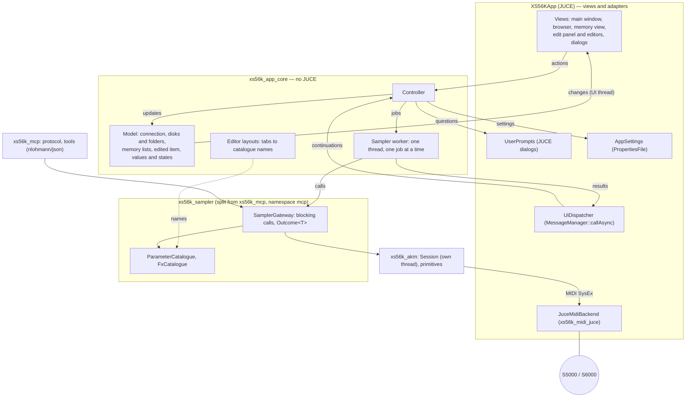
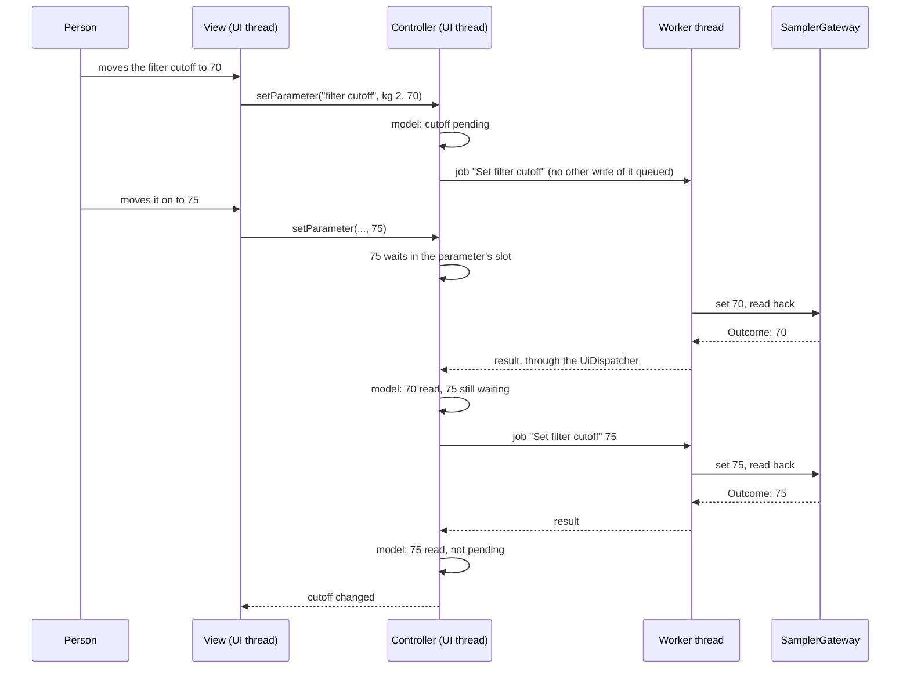

# ADR-APP-001: Editor Application Architecture — Light MVC, the Sampler Gateway Shared with the MCP Server, One Worker Thread

## Status
Proposed — drafted in session APP (2026-10-13) for TASK-APP-003, after the owner asked for "une architecture de type MVC légère" and left
the decisions to the assistant. Awaiting the owner's acceptance.

## Context

FTR-APP-001 to FTR-APP-009 describe the editor application (`juce/app`, today a placeholder window, RQ-BLD-007): a file browser of the
sampler's disks, a memory view by kind, an edit panel with tabs, a MIDI setup and a connection. Facts of this repository that shape the answer:

- `xs56k_akm`'s `Session` is asynchronous: `submit` returns at once, and every completion runs on the session's own thread (a
  `ThreadExecutor`), never on the caller's (ADR-AKM-001 DEC-AKM-004, DEC-AKM-005; `juce/akm/include/akm/Session.hpp`). The sampler takes one
  command at a time per port (RQ-AKM-008).
- The MCP server already has, in `juce/mcp`, a **sampler gateway** (`mcp::SamplerGateway`, `juce/mcp/include/mcp/SamplerGateway.hpp`) that
  composes the AKM primitives into the operations a person needs: open the session (naming a missing port and the ports available), list and
  select programs, samples, multis, song files, set lists and scenelists; read and set parameters with a read-back; browse, load and save
  through the disks with the slow-operation timeout and a save verified against a refreshed listing (DEC-MCP-017, DEC-MCP-018, DEC-MCP-022);
  delete only behind a typed confirmation (DEC-MCP-023, DEC-MCP-029). Each call blocks its caller until the sampler has answered and returns an
  `Outcome<T>`: a value, or a problem in plain words. It is "not thread-safe: one call at a time, from a thread that is neither the session's
  nor the MIDI backend's".
- The **parameter catalogues** (`mcp::ParameterCatalogue`: `standard()` for programs, `samples()`, `multis()`; the effects in `mcp/FxCatalogue.hpp`) name each
  parameter as the sampler's screen does, with its scope (program, keygroup, zone, sample, part), kind (number, signed, choice, switch), range,
  unit, labels and the conversion to and from the item's values (DEC-MCP-005).
- The gateway and the catalogues include nothing but `akm`, `common/midi` and each other (`#include` lines of `SamplerGateway*.cpp`,
  `GatewayDetail.hpp`, `ParameterCatalogue.cpp`, `StandardParameters.cpp`, `FxCatalogue.cpp`); nlohmann/json is used only by `McpServer.cpp`
  and `Tools.cpp`. Today all of them are one library, `xs56k_mcp`, which links nlohmann/json publicly.
- A source check (`juce/tests/CheckNoDestructiveCalls.cmake`, RQ-MCP-057) allows the AKM primitives that create, rename, delete, save, load or
  clear only in named files of the gateway.
- `xs56k_midi`'s `MidiBackend` lists the computer's MIDI ports by name and opens them (RQ-MID-001 to RQ-MID-003); `xs56k_midi_juce` is its JUCE
  implementation; the tests have a simulated backend and a simulated sampler (`xs56k_akm_test_support`: `SimulatedMidiBackend`,
  `SimulatedSampler`).
- `xs56k_framework` (ported from XplorerEditor) is built around one edited tone, a CC automation table and a paced transmit worker
  (`AbstractController.hpp`, RQ-FMW-030 to RQ-FMW-034).
- The headless CI workflows build the libraries and run `ctest` without `BUILD_APP` (AGENTS.md); `juce/app` is added only with `BUILD_APP=ON`.
- Requirements this ADR answers: the window never waits for the sampler (RQ-APP-012), slow operations (RQ-APP-013), the behaviour tested without
  the sampler and without a display (RQ-APP-014), the connection (RQ-APP-015 to RQ-APP-022), the edit cycle (RQ-APP-051 to RQ-APP-054), the
  tabs as groups the owner decides (RQ-APP-049, RQ-APP-056, RQ-APP-057), the confirmations (RQ-APP-011, RQ-APP-045).

## Decision

### DEC-APP-001: A light MVC — model and controller in a library without JUCE, views in the JUCE application
The application has three parts. The **model** holds what the application has read from the sampler and what the person is editing
(DEC-APP-004). The **controller** turns the person's actions into calls to the sampler and their results into changes of the model
(DEC-APP-003, DEC-APP-005, DEC-APP-007, DEC-APP-008). The **views** are JUCE components (main window, browser, memory view, edit panel and its
editors, dialogs): they draw the model, observe its changes and call the controller; they hold no state of the sampler and make no call to it.
The model and the controller form a static library, `xs56k_app_core`, with no JUCE type and no JUCE include; the views and the adapters that
give the core its JUCE services (DEC-APP-003, DEC-APP-007, DEC-APP-009) are in the `XS56KApp` target. [RQ-APP-014, RQ-APP-006]

### DEC-APP-002: The sampler is reached only through the gateway and the catalogues, split from `xs56k_mcp` into a library of their own
The gateway, its detail header and the catalogues (`SamplerGateway*.cpp`, `GatewayDetail.hpp`, `ParameterCatalogue.cpp`, `StandardParameters.cpp`,
`FxCatalogue.cpp` and their headers) become a static library `xs56k_sampler`, depending on `xs56k_akm` only (and through it on `xs56k_midi`); `xs56k_mcp` keeps the protocol, the
tools and the options (`McpServer.cpp`, `Tools.cpp`, `ServerOptions.cpp`) and links `xs56k_sampler` and nlohmann/json. **The files do not move and
the namespace stays `mcp`**: the change is in `juce/mcp/CMakeLists.txt` only, so the coverage generator (`generate_sysex_coverage.py` and
`sysex_coverage_declared.json`), the source check of destructive calls and the MCP tests keep their paths. The application links
`xs56k_sampler`, never `xs56k_mcp`. What the application needs and the gateway lacks is added to the gateway, with its tests, so the MCP server
and the application share one way of talking to the sampler; the application calls no AKM primitive that the destructive-call check confines.
[RQ-APP-010, RQ-APP-011, RQ-APP-013, RQ-APP-046, RQ-MCP-057]

### DEC-APP-003: One sampler worker thread runs the gateway's calls in order; results come back on the UI thread
The controller owns one **sampler worker**: a thread with a queue of jobs, each job a call (or a short sequence of calls) to the gateway and a
label in words ("Loading PAD.AKP"). The worker runs one job at a time, in order, which is the gateway's rule and the sampler's (RQ-AKM-008). When
a job ends, its result is handed to an injected **UI dispatcher**, which runs the continuation on the UI thread: the JUCE message thread in the
application (`juce::MessageManager::callAsync`), a queue the test drains in the tests. The model is changed only by these continuations, so it
needs no lock. The UI thread never waits for the worker: an action returns at once, the model says that the sampler is busy and with which job's
label, and the views stay live. [RQ-APP-012, RQ-APP-013, RQ-APP-019]

### DEC-APP-004: The model is a plain C++ snapshot of what was read, observed by the views
`xs56k_app_core` holds one model: the connection state and its reason (RQ-APP-019); the disks, the folders opened and the sampler's current folder
(FTR-APP-004); the six lists of the memory with their current items and the free memory (FTR-APP-005); the item being edited, its keygroup, and
for each parameter shown its last value read and its state — not read, read, pending, failed (RQ-APP-003, RQ-APP-052); the job in progress. A
value shown is always a value read from the sampler, never one the person asked for (RQ-APP-010). The views register as listeners of the model
through an interface of the core (no `juce::ChangeBroadcaster`, no `juce::ValueTree` in the core) and are told, on the UI thread, which part
changed. Because the sampler's front panel can change the memory or a value unseen, the model is read again after each action that can change it
and on the person's request (RQ-APP-036, RQ-APP-053). [RQ-APP-014, RQ-APP-019, RQ-APP-035, RQ-APP-052, RQ-APP-053]

### DEC-APP-005: A parameter is named and bounded by the catalogue, read before it is shown, set then read back, one write pending at a time
The editors take each parameter's name, scope, kind, range, unit and labels from the gateway's catalogues (`ParameterCatalogue::standard()` for a
program), so the application and the MCP server name and bound a parameter the same way (RQ-APP-051). A tab's parameters are read through the
gateway when the tab is shown and when the edited item or keygroup changes (RQ-APP-053). A change is a job that sets the value and reads it back,
which the gateway already does (DEC-MCP-006); the parameter is pending until the job ends (RQ-APP-052). For each parameter and target (keygroup
or zone) the controller keeps **at most one write in the queue or in progress**: a new value given while one is pending replaces the value
waiting to be sent, and is sent when the pending write ends, so the last value given is the last value sent (RQ-APP-054). A job that acts on the
edited item first makes it the sampler's current item when the model does not record it as current (RQ-APP-037). [RQ-APP-051 to RQ-APP-054,
RQ-APP-058]

### DEC-APP-006: The tabs are data — an editor layout that lists, for each tab, the catalogue parameters it holds
An editor's tabs are not code: an **editor layout** in `xs56k_app_core` lists the tabs of each editor, each tab with its title and the catalogue
names of its parameters, in order. The owner's groups (TASK-APP-002) are written there, and changing them changes no view. A unit test checks the
layout against the catalogue: every name exists, and every parameter of the inventory of FTR-APP-008 is in at least one tab (RQ-APP-057); a tab
may mix scopes, each parameter showing its own (RQ-APP-056). [RQ-APP-049, RQ-APP-056, RQ-APP-057]

### DEC-APP-007: Every question to the person goes through an injected prompts interface, and nothing is sent before the answer
The controller asks its questions — the confirmation of a destructive action (RQ-APP-011), the answer to a name already on the disk
(RQ-APP-045), the confirmation of a folder load (RQ-APP-029) — through an interface of the core, `UserPrompts`, whose answer comes back
asynchronously. The application implements it with JUCE dialogs that do not block the message thread; the tests implement it with scripted
answers. The job is queued only after the answer, and a cancel queues nothing. When the gateway asks for a typed confirmation (an exact name, a
count), the controller passes the name or the count the person confirmed. [RQ-APP-011, RQ-APP-029, RQ-APP-034, RQ-APP-045]

### DEC-APP-008: One gateway per connection; connecting opens and reads, disconnecting destroys it, quitting waits for the job in progress
"Connect" creates a gateway on the configured ports and DeviceID and queues a job that opens the session and reads what the window shows first:
the sampler's model, name and version, the disks, the memory lists (RQ-APP-017); a failure keeps the state disconnected with the gateway's
problem, which names a missing port and the ports available, or the DeviceIDs that answered (RQ-APP-018). While disconnected the controller
queues no job, so the gateway's own "open when first needed" never reconnects behind the person's back (RQ-APP-019). "Disconnect", a change of
ports or DeviceID (RQ-APP-020) and a lost port (RQ-APP-022) end the gateway: queued jobs are dropped, the job in progress ends, then the gateway is
destroyed, which closes the session (`~SamplerGateway` calls `close()`, RQ-AKM-042) and frees the ports. Quitting does the same without blocking the
message thread: the application quits when the disconnection's continuation runs, the window saying what it is waiting for (RQ-APP-021).
[RQ-APP-017 to RQ-APP-022]

### DEC-APP-009: The settings are behind an interface of the core
The MIDI ports, the DeviceID, "connect at start", "check names" and the window's layout are read and written through an `AppSettings` interface
of the core; the application implements it with `juce::PropertiesFile` in the person's settings folder, the tests in memory. The MIDI setup dialog
lists the ports through `common::midi::MidiBackend` (RQ-MID-001), on the UI thread: listing the ports sends nothing to the sampler.
[RQ-APP-009, RQ-APP-015, RQ-APP-016, RQ-APP-023]

### DEC-APP-010: Where the code and the tests live
- `juce/app/core/` — `xs56k_app_core` (model, controller, worker, editor layouts, the interfaces `UiDispatcher`, `UserPrompts`, `AppSettings` and
  the model's listener), added by `juce/CMakeLists.txt` **with the libraries, whatever `BUILD_APP` says**, so that the headless workflows build and
  test it; it links `xs56k_sampler` and `xs56k_midi`, no JUCE module. A check of the kind of `CheckNoJuceIncludes.cmake` keeps JUCE out of it.
- `juce/app/src/` — `XS56KApp`: `Main.cpp`, the views, the JUCE adapters of the three interfaces, the JUCE MIDI backend.
- `juce/tests/app/` — Catch2 tests of `xs56k_app_core`, named by the RQ-APP they verify, run by `ctest`: the controller and the model against the
  gateway over the simulated backend and the simulated sampler, with a real worker thread and a UI dispatcher the test drains (a helper waits for
  the worker to be idle, then runs the continuations). The views are thin and are not unit-tested; what they must do is in the core.
[RQ-APP-014, RQ-BLD-014]

## Consequences

- **Easier.** The application reuses the gateway's tested behaviour — opening, selection, read-back, slow timeouts, verified saves, typed
  confirmations — instead of a second, asynchronous copy of it; a fix to the gateway serves both the MCP server and the application. The UI
  thread never waits for the sampler. The core is tested headlessly in CI against the simulated sampler. The owner's tab groups are data. The
  destructive-call check needs no new allowed file.
- **Harder or constrained.** One job at a time: a load or a save (up to the disk timeout, 120 s by default) delays every edit queued behind it, and
  a job in progress cannot be cancelled — the busy indicator says what is running. Quitting during a slow job waits for it. The application's code
  sees the namespace `mcp` and the directory `juce/mcp` for things that are not MCP; renaming them is left out because it would move files that the
  coverage generator, its declared data and the source check name. The gateway's API was shaped for the tools (names, problems in words): what the
  application needs beyond it is added to the gateway, with tests, in the tasks that need it. The gateway's own guards stay in force for the
  application (typed confirmations), on top of the application's dialogs.
- **Follow-up tasks** (planned after this ADR is accepted): split `xs56k_sampler` from `xs56k_mcp` (CMake only, the MCP tests unchanged);
  create `xs56k_app_core` with the worker, the dispatcher, the model and the connection (FTR-APP-003), then the browser, the memory view, the save
  and the editors, each feature with its tests first.

## Alternatives Considered

- **The application calls the AKM primitives itself, asynchronously, without the gateway.** Rejected: it would rewrite, in a second form, the
  composite behaviour the gateway already has and tests (selection, read-back, save verification, typed confirmations, slow timeouts), and it
  would add call sites of destructive primitives that the source check confines to the gateway (RQ-MCP-057).
- **The gateway called on the UI thread, as the MCP server calls it on its main thread (DEC-MCP-003).** Rejected: every call would freeze the window
  for the sampler's answer, up to two minutes for a load (RQ-APP-012).
- **The application links `xs56k_mcp` as it is.** Rejected: the application would depend on the JSON-RPC server and the tools, and on
  nlohmann/json, for none of which it has a use; the split costs a CMake change only.
- **The gateway and the catalogues moved to a new directory and namespace (`juce/sampler`, `sampler::`).** Rejected for now: it moves files that
  `generate_sysex_coverage.py`, `sysex_coverage_declared.json` and `CheckNoDestructiveCalls.cmake` name, for a gain in naming only; it can be done
  later on its own.
- **The framework's controller (`midiapp::AbstractController`, ported from XplorerEditor).** Rejected: it is built around one edited tone, a CC
  automation table and a paced transmit worker; the sampler is a request-and-answer device holding many items.
- **A model of `juce::ValueTree` and `juce::ChangeBroadcaster`.** Rejected for the core: it would put JUCE in it and need a message loop in the tests
  (RQ-APP-014); a view may still adapt the model's notifications to JUCE.
- **Several worker threads, or one per request.** Rejected: the gateway allows one caller at a time and the sampler one command at a time per port;
  more threads would only add ordering problems.

## Diagram

