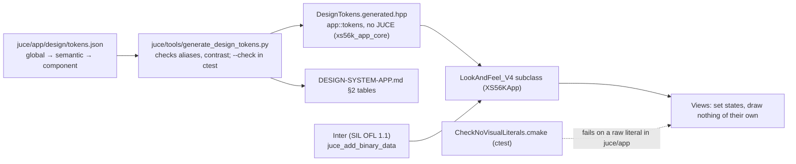

# ADR-APP-002: Design System — One Token File, a Generated Token Module, One Look-and-Feel, a Literal Check, an Embedded Font

## Status
Proposed — drafted in session APP (2026-10-13) for TASK-APP-004, with the owner's choices of that day (style inspired by the plugin Vital,
colours by role, knobs with their value, an embedded free font, a compact display). Awaiting the owner's acceptance.

## Context

The AGNOS process requires, before the first UI task, a design system that is a single machine-readable source of truth consumed by code as
tokens, captured as an ADR stating the token structure, its tiers and its generation and verification (MANDATORY DESIGN SYSTEM).
RQ-APP-001 to RQ-APP-005 ask for: one document instantiated from the template, one token module in three tiers with no UI context, a table of
interaction states with a "pending" state, no raw visual literal outside the token module (checked), and no meaning by colour alone. The
document is `process/1.requirements/DESIGN-SYSTEM-APP.md`.

Facts of this repository that shape the answer:

- The project already keeps data in one reviewed file and generates code from it with a Python script that has a `--check` run as a `ctest`
  entry: the item catalogue (`juce/akm/data/items.json` → `ItemTable.generated.hpp`, ADR-AKM-001 DEC-AKM-003, DEC-AKM-012) and the coverage
  table (`generate_sysex_coverage.py`, ADR-MCP-006 DEC-MCP-039). No script runs during the build (AGENTS.md).
- ADR-APP-001 puts the model and the controller in `xs56k_app_core`, without JUCE, tested headlessly (DEC-APP-001, DEC-APP-010), and the views
  in `XS56KApp`.
- JUCE draws its standard components through a `juce::LookAndFeel`; `juce_add_binary_data` embeds files in a target.
- Inter is licensed under the SIL Open Font License 1.1 (`LICENSE.txt` of github.com/rsms/inter, read on 2026-10-13); the OFL allows embedding
  a font in software with its licence.
- There are source checks run as `ctest` entries (`CheckNoJuceIncludes.cmake`, `CheckNoDestructiveCalls.cmake`).

## Decision

### DEC-APP-011: The token file `juce/app/design/tokens.json` is the single source of truth, in three tiers
Every global, semantic and component token of the design-system document is one entry of `juce/app/design/tokens.json`: a global token holds
a value (a colour as `#RRGGBB`, a size in logical pixels, a duration in milliseconds, a font file and weight); a semantic token names the
global token it aliases; a component token names the semantic (or, for sizes, global) token it aliases. One theme, dark (the document's §2.1).
The value tables of the document's §2 are written from this file by the generator, between markers, and checked by its `--check`, as
`documents/SYSEX-COVERAGE.md` is from its sources. [RQ-APP-001, RQ-APP-002]

### DEC-APP-012: A generator writes the token module into `xs56k_app_core`, without JUCE
`juce/tools/generate_design_tokens.py` reads the token file, checks it (every alias resolves, down the tiers, to a global value; no cycle; no
component token holding a value; the contrast of every text pair the document lists is at least 4.5 : 1) and writes
`juce/app/core/include/app/DesignTokens.generated.hpp`: `constexpr` constants in namespace `app::tokens`, named by the transliteration of the
document's §2 (`colour.surface.panel` → `kColourSurfacePanel`), colours as `std::uint32_t` ARGB, sizes as `float`, durations as
`std::chrono::milliseconds`. `--check` fails when the header or the document's tables are behind the token file; it is a `ctest` entry when
CMake finds Python 3, and no script runs during the build. The header includes no JUCE file, so the token module is tested headlessly.
[RQ-APP-002, RQ-APP-005]

### DEC-APP-013: One look-and-feel draws every standard component from the tokens
One `juce::LookAndFeel_V4` subclass in `XS56KApp` is the only code that turns tokens into drawing (colours, fonts, radii, strokes) for the
knobs, value boxes, choice selectors, switches, tabs, rows, buttons, dialogs and the status bar of the document's §4; the views set the state
properties (selected, active, pending, error) that it reads, and draw no visual value of their own. [RQ-APP-002, RQ-APP-003]

### DEC-APP-014: A source check forbids raw visual literals outside the token module
A `ctest` entry, `CheckNoVisualLiterals.cmake` (of the kind of `CheckNoJuceIncludes.cmake`), fails when a source of `juce/app` other than the
generated token header contains a colour literal (`juce::Colour (` or `Colour (` followed by a number, `Colour::fromRGB`, `fromRGBA`,
`fromFloatRGBA`, `juce::Colours::`) or a numeric literal passed to a font height, a corner radius, a stroke width or a spacing call that the
check lists, and names the file and the line. [RQ-APP-004]

### DEC-APP-015: Inter is embedded with its licence; the system's sans-serif is the fallback
The regular and medium weights of Inter, at a version pinned when they are added, are stored under `juce/app/resources/fonts/` with the
font's `LICENSE.txt` (SIL OFL 1.1), embedded in `XS56KApp` with `juce_add_binary_data`, and set as the look-and-feel's typeface; if the font
cannot be loaded, the system's default sans-serif is used and the failure is logged. The licence file is shipped with the application. [RQ-APP-001]

### DEC-APP-016: A colour belongs to a parameter's family, not to the tab it is in
Each parameter of an editor layout (DEC-APP-006) carries a role — sample, modulation, filter, general — that decides its colour
(`colour.role.*`); a tab that mixes families shows each parameter in its own colour; each role colour comes with its group's label, and each
status colour with a word or an icon (the document's §3). [RQ-APP-005, RQ-APP-056]

## Consequences

- **Easier.** A colour or a size is changed in one file; the C++ constants and the document follow, and `--check` catches a forgotten
  regeneration. The token module is tested headlessly with the core. A raw literal slipped into a view fails the tests. The look stays the same on
  Windows, macOS and Linux thanks to the embedded font.
- **Harder or constrained.** A new token needs an edit of the token file and a regeneration before it can be used. The binary data adds the font
  files (some hundreds of kilobytes) to the repository and the application. The literal check is a pattern search: it cannot see a literal hidden
  behind an arithmetic expression, so review still matters. The editor layouts carry a role per parameter, which the owner's groups (TASK-APP-002)
  will need to state.
- **Follow-up tasks** (planned with the implementation, after the owner's quality branch is merged): the token file and its generator with
  tests; the literal check; the look-and-feel; the font.

## Alternatives Considered

- **A hand-written C++ header as the source of truth.** Rejected: the document's tables and the header would be two sources that drift; the
  project already generates code from reviewed data files.
- **The token values only in the Markdown document, parsed by the generator.** Rejected: a Markdown table is a fragile input format; the JSON file
  is simpler to validate and to read in tests.
- **Tokens as `juce::Colour` and `juce::Font` objects.** Rejected for the module: it would put JUCE in `xs56k_app_core` (ADR-APP-001 DEC-APP-001);
  the look-and-feel converts the plain values.
- **The system font only.** Rejected by the owner (2026-10-13): the rendering would differ between operating systems.
- **A light theme, or a theme per user.** Not wanted now (the document's §10); the token file's structure leaves room for a second value per
  semantic token.

## Diagram

