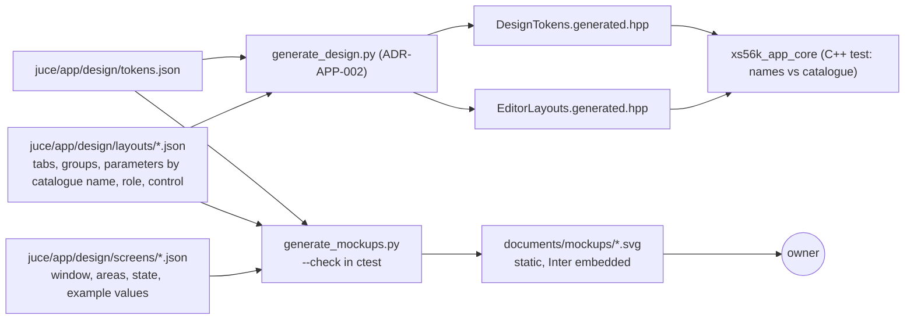

# ADR-APP-003: SVG Mockup Generator — Screen Descriptions as Shared Data, Static Self-Contained SVG, a `--check` That Keeps Them in Step

## Status
Proposed — drafted in session APP (2026-10-13) for TASK-APP-006, after the owner proposed a tool that draws SVG mockups from the design system
"to prototype the interface and exchange between us before generating code", and answered: static mockups; the description of the screens
serves again for the code; the requirements are added to FTR-APP-001 (RQ-APP-074 to RQ-APP-078). Awaiting the owner's acceptance.

## Context

- The design system (`process/1.requirements/DESIGN-SYSTEM-APP.md`, ADR-APP-002) keeps every visual value in one token file,
  `juce/app/design/tokens.json`, from which a generator writes the C++ token module and the document's tables (DEC-APP-011, DEC-APP-012). Its
  §7.4 requires a mechanism that keeps mockups in step with the tokens; "no mechanism" is not acceptable (the template's words).
- ADR-APP-001 makes the editors' tabs data — the editor layouts, each tab listing the catalogue parameters it holds (DEC-APP-006) — with a role per
  parameter deciding its colour (ADR-APP-002 DEC-APP-016).
- The project's generators are Python 3 scripts in `juce/tools/` with a `--check` run as a `ctest` entry when CMake finds Python 3, unit tests in
  `juce/tests/tools/`, and no script run during the build (AGENTS.md; `generate_akm_items.py`, `generate_sysex_coverage.py`).
- The parameter catalogues (names, ranges, labels) are C++ (`mcp::ParameterCatalogue`, ADR-APP-001 DEC-APP-002); a Python script cannot read them.
- The font is Inter (SIL OFL 1.1, DEC-APP-015); an SVG can embed a font as a base64 `@font-face`.
- The container in which the assistant works has Chromium (Playwright), which can render an SVG to PNG for checking.

## Decision

### DEC-APP-017: `juce/tools/generate_mockups.py`, Python 3 standard library only, outside the build
The generator reads the token file and the screen descriptions and writes the mockups; it uses the Python standard library only, runs by hand
like the other generators (`python3 juce/tools/generate_mockups.py`, `python` on Windows), and never during the build. [RQ-APP-074]

### DEC-APP-018: Two kinds of description — editor layouts shared with the application, screens for the mockups only
- **Editor layouts**, `juce/app/design/layouts/<editor>.json`: the tabs of an editor, each with its title and its groups; each group with its title
  and its parameters, each parameter by its **catalogue name** (`"filter cutoff"`), its short label as drawn (`"CUTOFF"`), its role (sample,
  modulation, filter, general) and its control (knob, choice, switch, value box). These are the editor layouts of DEC-APP-006. The design
  generator of ADR-APP-002 (renamed `generate_design.py`, DEC-APP-012) writes them, besides the tokens, into the C++ table
  `EditorLayouts.generated.hpp` of `xs56k_app_core`; a C++ unit test checks every catalogue name against the catalogue and the inventory of
  FTR-APP-008 (RQ-APP-057). The mockup generator reads the same files.
- **Screens**, `juce/app/design/screens/<screen>.json`: what only a mockup needs — the window's size, which areas show what, which editor layout
  and tab is shown, the state (connected, disconnected, busy, a dialog open), and **example values** (a file tree, memory lists, parameter
  values). A screen names tokens by their spec names (`colour.surface.panel`), never a literal; a name that is not in the token file fails the
  generator. [RQ-APP-075, RQ-APP-049, RQ-APP-056]

### DEC-APP-019: One static, self-contained SVG per screen and state, in `documents/mockups/`
Each screen and state gives one SVG file, `documents/mockups/<screen>-<state>.svg`, at the window's logical size, embedding Inter as a base64
`@font-face` from the font files of DEC-APP-015, with a caption in a corner: the screen, the state, and "example values". No script, no
external reference, no interactivity. The mockups are committed and listed in `documents/INDEX.md`. [RQ-APP-074, RQ-APP-076]

### DEC-APP-020: `--check` keeps the committed mockups in step; the generator is tested first
`--check` regenerates every mockup in memory and fails, naming them, when a committed file differs; it is a `ctest` entry when CMake finds
Python 3, like the other generators' checks. The output is deterministic (sorted keys, fixed number formatting) so that the check compares bytes.
The unit tests (`juce/tests/tools/test_generate_mockups.py`) are written before the generator. [RQ-APP-077, RQ-APP-078]

### DEC-APP-021: The mockup is faithful in tokens and layout, not to the pixel
The SVG drawing and the JUCE look-and-feel (DEC-APP-013) are two renderers of the same tokens and layouts: colours, sizes, spacings, radii,
strokes, fonts and the placement of groups and controls are the same; anti-aliasing, text metrics and the exact shape of a knob's pointer may
differ. When they disagree on something the design system states, the design system decides and the wrong renderer is fixed; what the design
system does not state is decided in the design system first (its §0). The mockups are the reference for discussing the interface, not a
pixel test of the application. [RQ-APP-074]

## Consequences

- **Easier.** A tab's groups, a colour or a spacing can be shown to the owner in minutes, without building JUCE; the editor layouts are written
  once and used by both the mockups and the application; the assistant can render a mockup to PNG to look at it before sending it.
- **Harder or constrained.** The token file and the design generator come first (the mockup generator reads them), before the mockups. Two
  renderers exist and must be kept to the design system. Committed SVGs with an embedded font are large (the font's size for each file); the
  font could be shared by one file per mockup set later if the size bothers. The example values of a screen are not checked against the
  catalogue's ranges (the catalogue is C++); a label or a range shown in a mockup may be wrong until the application shows it.
- **Changes to ADR-APP-002 and the document.** DEC-APP-012's script is renamed `generate_design.py` and also writes the editor layouts; the
  document's §7.4 names this generator as the mockup mechanism and its §8 adds the `--check` of the mockups.
- **Follow-up tasks** (none depends on the owner's quality branch): the token file and the design generator; the mockup generator; the first
  mockups (main window, connected and disconnected, a confirmation dialog); the program editor's mockups once the owner's groups exist
  (TASK-APP-002).

## Alternatives Considered

- **Mockups drawn by hand in a vector editor (Inkscape, Figma).** Rejected: they would copy token values by hand and drift; the template asks for
  a mechanism.
- **An HTML page with interactive tabs.** Rejected by the owner (2026-10-13): static mockups first.
- **Mockups rendered by the JUCE application itself (screenshots of a mockup mode).** Rejected for now: it needs the application's views first,
  which is what the mockups are meant to precede.
- **Screen descriptions written in C++ or read from the catalogue at generation time.** Rejected: the generator would need a C++ build; the
  catalogue names in the layouts are checked by a C++ unit test instead (DEC-APP-018).
- **One description file for everything, layouts and example values mixed.** Rejected: the application would read example values it has no use
  for; the layouts are the shared part, the screens the mockup-only part.

## Diagram

