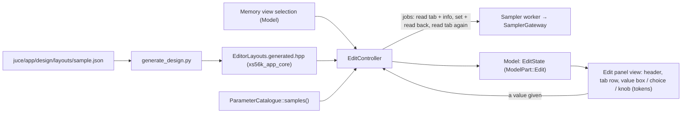

# ADR-APP-004: The Edit Panel and its First Editor — Generated Layouts, One Edit Controller, Controls from the Tokens

## Status
Proposed — drafted in session APP (2026-10-15) for TASK-APP-034, after the owner asked for the sample editor (FTR-APP-010).

## Context

FTR-APP-010 asks for the first editor of the edit panel, the sample's; FTR-APP-007 gives the rules every editor shares (RQ-APP-048 to RQ-APP-055).
What already exists or was decided:

- ADR-APP-001: a parameter is named and bounded by the gateway's catalogues, read before it is shown, set then read back, at most one write
  pending per parameter (DEC-APP-005); the tabs are data, an editor layout per editor (DEC-APP-006); the model is a snapshot observed by the views
  (DEC-APP-004); the sampler is reached on one worker thread (DEC-APP-003).
- ADR-APP-003 DEC-APP-018: the layouts are `juce/app/design/layouts/<editor>.json` (tabs, groups, parameters by catalogue name, label, role,
  control), written by `generate_design.py` into `EditorLayouts.generated.hpp`. **That generation was never written**: only an example program
  layout exists (`juce/app/design/examples/`), read by the mockups alone.
- The gateway reads and writes a parameter of the current sample (`readSampleParameter`, `writeSampleParameter`, RQ-MCP-020); the catalogue
  `ParameterCatalogue::samples()` has the eight settable and four read-only rows.
- The design system has component tokens for knobs, value boxes and choices (ADR-APP-002), never drawn by the application yet.
- On the real S5000, Set Loop End moves Loop Start (OBSERVATIONS-RQ-AKM-051).

## Decision

### DEC-APP-024: The editor layouts are generated into the core, and checked against the catalogue
`generate_design.py` reads `juce/app/design/layouts/*.json` (not the examples) and writes `EditorLayouts.generated.hpp` in `xs56k_app_core`: per
editor, its tabs, groups and parameters (catalogue name, label, role, control), with `--check` as for the tokens. A C++ test checks every name
against the editor's catalogue. The first layout is `sample.json` (RQ-APP-086). [RQ-APP-086, RQ-APP-049, DEC-APP-006, DEC-APP-018]

### DEC-APP-025: One edit controller in the core, generic over the catalogue, its state in the model
`EditController` (`xs56k_app_core`) follows the memory view's selection: for a kind that has a layout it reads, on the worker, the tab's
parameters and the editor's read-only rows, and puts an `EditState` in the model (`ModelPart::Edit`: the item, the tab, each parameter's value,
range, labels, pending flag). A write is a job that sets and reads back (the gateway does both), at most one per parameter in flight, the latest
value waiting (DEC-APP-005). Before each job it makes the edited item the sampler's current one if it no longer is, as the browser does for its
disk (TASK-APP-032). The kind decides the catalogue and the layout; the program editor (FTR-APP-008) will add its keygroup to the state.
[RQ-APP-048, RQ-APP-050 to RQ-APP-054, RQ-APP-087]

### DEC-APP-026: After a write, the whole tab is read again
Once a write is read back, the controller reads every parameter of the tab again (eight Gets for the sample tab), so a value the sampler changed
on its own is shown (Loop Start after Set Loop End). A position beyond the sample's length is refused before anything is sent, the length being
read with the read-only rows. [RQ-APP-088, RQ-APP-089]

### DEC-APP-027: Four controls drawn by the look-and-feel from the tokens
`XS56KApp` gets a value box (a number typed, or dragged; the unit beside it), a choice (the catalogue's labels), a knob with its value box and a
horizontal slider with its value box (`slider.*` tokens), each
drawn by the look-and-feel from the component tokens (`valuebox.*`, `choice.*`, `knob.*`), the pending state in `colour.status.pending` with a
second cue (RQ-APP-005). The layout's `control` picks the control; a position is a slider (musicians drag, and can type the exact point; owner, 2026-10-15), the playback mode a choice, the tunings knobs, the
original pitch a value box that reads a note name. The mockup generator draws the same four controls (`valuebox`, `choice`, `knob`, `slider`, its
`draw_*` functions) with the same tokens and the same cell geometry (a knob cell, a choice or a value box two cells wide, a slider three): the layout's `control`
names are the contract between the mockups and the C++ controls, which reproduce that geometry. [RQ-APP-051, RQ-APP-086, RQ-APP-003, RQ-APP-005,
ADR-APP-002, ADR-APP-003]

## Consequences

- **Easier.** The program editor reuses the controller, the controls and the layout generation: it adds a layout and a keygroup selector. The
  owner changes the grouping by editing a JSON file.
- **Harder or constrained.** A write costs nine sampler round trips (Set, Get, then the tab), a fraction of a second on MIDI; RQ-APP-054's
  coalescing keeps a dragged control from queuing more. The generator gains a second output and its tests.
- **Follow-up tasks**: PLAN-APP-005.

## Alternatives Considered

- **Reading back only the parameter written.** Rejected: misses Loop Start moved by Set Loop End (RQ-APP-089).
- **Reading only the loop start after a loop end.** Rejected: encodes one observation whose rule is not established (OBSERVATIONS-RQ-AKM-051, F4).
- **A hand-written C++ layout.** Rejected: DEC-APP-006 makes the tabs data, and the mockups read the same JSON.
- **JUCE's standard Slider and ComboBox drawn by `LookAndFeel_V4` as they are.** Rejected: their look is not the design system's; they are kept,
  drawn by our look-and-feel.

## Diagram

