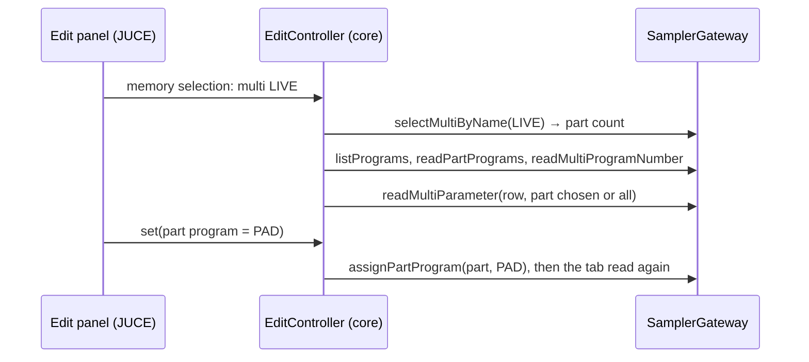

# ADR-APP-006: The Multi Editor — the Edit Panel's Third Editor

## Status
Proposed — drafted in session APP (2026-11-01) for PLAN-APP-008, after the owner asked for the multi editor (FTR-APP-011).

## Context
FTR-APP-011 (RQ-APP-100 to RQ-APP-104) asks for a multi editor. The edit panel already edits samples and programs through one `EditController`,
an editor layout per kind generated from `juce/app/design/layouts/` (ADR-APP-004, DEC-APP-024, DEC-APP-025), and shows a program one keygroup at a
time with a selector and "All keygroups" (DEC-APP-030, TASK-APP-050). A multi is shaped the same way: a fixed number of parts (32, 64 or 128), the
same twelve parameters per part, read and written by the gateway one part or all parts at a time (`readMultiParameter`, `writeMultiParameter`,
`PartSelection`). What has no catalogue row: the program a part plays (`readPartPrograms`, `assignPartProgram`, `clearPart`) and the multi's
program number (`setMultiProgramNumber`, which reads it back; the gateway has no reading of it alone).

## Decision

### DEC-APP-041: A multi binding of the edit controller; the part chosen as a program's keygroup is
The `EditController` gains a binding for multis: the multi catalogue, the multi made current by name (its part count coming back as a program's
keygroup count does), the part parameters read and written for the part chosen or for all parts. The edit state's keygroup count and keygroup
chosen hold, for a multi, its part count and the part chosen (`ALL_KEYGROUPS` for all parts), so that the choice, the "VARIES" and the
forgetting of a write for another part are those of the keygroups. The layout `multi.json` holds one tab, "Parts", with groups of two new scopes,
`multi` and `part`. The view's selector reads "Part n of N" with the part's program, and the program editor's add and delete buttons are not
shown for a multi. [RQ-APP-100, RQ-APP-101]

### DEC-APP-042: The program of a part is a choice among the programs in memory
As a zone's sample (DEC-APP-033), a part's program has no catalogue row: a value named "part program" is 1 plus the program's place in memory, 0
none, with the new control `program`; the programs in memory and the program of each part are read with the tab (`listPrograms`,
`readPartPrograms`), and the selector shows them. A program chosen is assigned by name (`assignPartProgram`); none takes it away (`clearPart`, the
multi's own name as its confirmation, with no question: the program stays in memory). With all parts chosen, a change of program is refused with
nothing sent. [RQ-APP-101, RQ-APP-102]

### DEC-APP-043: The program number is a value of multi scope; the gateway reads it alone
A value named "multi program number" is a choice of 129 labels, "OFF" then 1 to 128, read by a new gateway call `readMultiProgramNumber` (`&41`,
already sent by `setMultiProgramNumber` to read back) and set with `setMultiProgramNumber`. The memory view's context menu gains "New multi…":
the name is asked, a name taken is refused with nothing sent, and the multi is created with the part count the sampler gives new multis (`&01`,
which the application does not send). [RQ-APP-103, RQ-APP-104]

## Consequences
- No new controller: the multi editor is a binding, a layout and two pseudo-parameters; the keygroup code serves the parts.
- With all parts chosen, a reading asks each of 32 to 128 parts each parameter: slow on the real sampler, as all keygroups of a big program are.
- The MCP server does not change; the gateway gains one reading.

## Alternatives Considered
- **A mixer of all parts at once** (a row per part): 32 to 128 rows of twelve controls; a new grid the layouts do not have. Left for later if the
  owner asks.
- **Setting the parts of new multis before the creation**: a stored setting of the sampler no item reads back; the sampler's own value is kept.

## Diagram

