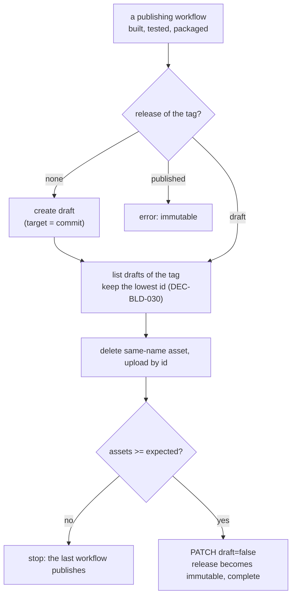

# ADR-BLD-006: Draft Release, Published by the Last Workflow

## Status
Accepted — owner decision ("spécifie et implémente le brouillon"); implemented by TASK-BLD-013
(PLAN-BLD-005). Motivated by RQ-BLD-016. Amends the publishing step of ADR-BLD-003, whose
`publish-deployment` created the release already published.

## Context

The six preprod workflows (and the three prod ones) are independent and publish into one release per
commit. `publish-deployment` created the release if absent (`gh release create`, published at once) and
uploaded its archive. With GitHub's release immutability enabled, a published release takes no more
assets: the first workflow published an empty release and the others failed with `HTTP 422: Cannot upload
assets to an immutable release` (run 38882613846). The release `2026.10.16-0945-preprod` is immutable and
has no asset.

Immutability is kept: it protects what users download. Draft releases stay editable until published, and
publishing a draft is what makes it immutable, with its assets.

## Decision

### DEC-BLD-029: Attach to a draft, the workflow that attaches the last archive publishes
`publish-deployment` creates the release as a draft, attaches the archive to it, counts the assets of the
draft and, when the count reaches the `expected-assets` input, publishes it.
- **Expected count.** The generator passes it from the matrix (preprod 6, prod 3), once, in the shared
  publish step; the action has no knowledge of the matrix.
- **Publish.** `PATCH draft=false`, with `make_latest` true for prod and false for preprod (a draft cannot
  be marked latest when created). The tag of a preprod release does not exist before this point: the draft
  is created with `target_commitish` = the commit, so the tag is created on that commit when published.
  For prod the tag exists (pushed by cut-deployment).
- **Last one wins, nobody else.** An upload is complete before its workflow counts, so the workflow whose
  upload completes last sees every asset. If two see them at once both publish; the second `PATCH` finding
  the release already published is not an error.
- **Failure.** A workflow that fails never attaches: the draft stays unpublished and invisible to users,
  rather than a release missing a platform. Such drafts are deleted by hand.
- **Published already.** A release found published is an error (it is immutable): re-running a workflow
  after the release is complete fails, which is accurate.
- **Where.** The logic is `.github/actions/publish-deployment/publish.sh`, called by the action, so that
  a test can run it against a stand-in `gh` and `curl` (`juce/tests/tools/test_publish_deployment.py`).

### DEC-BLD-030: One draft per tag, the oldest wins
Draft releases of the same tag do not conflict (published ones do), so concurrent creators make
duplicates. After creating, a workflow lists the releases of its tag and keeps the one with the lowest id;
if it is not its own it deletes its own and attaches to the oldest. Ids grow with creation, so every
workflow reaches the same choice. A release is addressed by its id, never by its tag (a lookup by tag of a
draft returns the newest, which may be the one about to be deleted), and archives are uploaded to it with
`curl` on the id, since `gh release upload` takes a tag.
- **Re-run.** An archive of the same name already on the draft is deleted before the upload (the
  `--clobber` of before).

## Consequences

**Easier.** The releases of a commit are complete and immutable, or absent; the setting stays on.
Users never see a half-published deployment.

**Harder.** A workflow that fails leaves a draft to clean up, and a draft whose workflows were not all
triggered (a push that changes the file of one workflow only) never completes. A platform added to the
matrix changes the expected count, which comes from the same matrix. The logic is bash, tested against a
stand-in of `gh`; its calls to GitHub are exercised only by CI. XplorerEditor, the origin of this setup,
has the same publish step and the same setting; it is not changed here.

## Alternatives Considered

- **Disable release immutability.** Rejected by the owner's choice; it removes a protection to avoid a
  change in one action.
- **A final job that publishes after the others (`needs:`).** Rejected: the workflows are separate files
  by design (RQ-BLD-006); a job cannot wait for another workflow.
- **One workflow building all platforms in a matrix.** Rejected: RQ-BLD-006, RQ-BLD-008.
- **Lock with the tag (create the git tag first, atomically).** Rejected: more steps and waiting for the
  loser; deleting the duplicate is simpler and enough.
- **Count in `gh release upload` by tag.** Rejected: ambiguous with duplicates (DEC-BLD-030).

## Diagram

