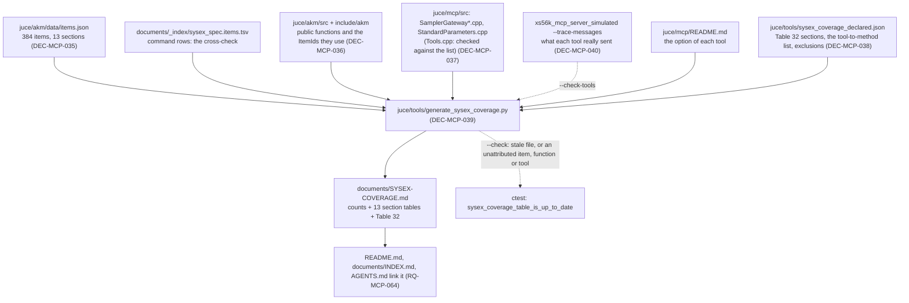

# ADR-MCP-006: The Generator of the SysEx Coverage Table — Rows, the Two Columns, Declared Facts, and the Check That Keeps It Right

## Status
Proposed — drafted in session MCP (2026-10-10) for FTR-MCP-006 (RQ-MCP-058 to RQ-MCP-066), after the owner asked for a table of the
specification's messages by section, with the AKM function and the MCP tool of each, generated into a Markdown file referenced by the root
`README.md`, by a tool kept in `juce/tools`. No independent review by a second model was run on this record.

## Context

The question the table answers is whether the AKM library sends every message of the specification and the MCP server offers every function
the specification gives. Four facts decide how it can be answered (read in the repository on 2026-10-10, `FTR-MCP-006`):

1. The messages are already data: `juce/akm/data/items.json` holds 384 items, checked against the specification's command rows by
   `generate_akm_items.py --coverage`. The 176 REPLY rows of the spec's list are the replies of the Gets, not messages.
2. The specification's Table 32 has eight sections that the catalogue does not hold at all (the index forms `2A 2C 2E 32` and the blocked
   multi-requests `38 3A 3C 3E`). A table built from the catalogue alone would not show that they are missing.
3. The AKM library does not have a function per message. Some messages have a named function; many are built by the catalogue
   (`akm::makeRequest(ItemId::X)`, `Session::submit`) from the MCP server's own code (`StandardParameters.cpp`). A text search finds 158 of the
   384 item names in the AKM sources, 226 in the MCP sources, 4 in neither.
4. The MCP tools do not call the AKM library directly: a tool (`Tools.cpp`, 77 tools, some registered from tables) calls a method of the
   gateway (`SamplerGateway*.cpp`), which calls an AKM function or builds a request. The link from a message to a tool is two steps long.

A table kept by hand would be wrong within a few commits, and the owner asked for a tool that can be run again. The risk of the other extreme
is a scanner that reads C++ with regular expressions and is fooled by the next refactoring; the decisions below keep the scanner small and make
the build fail when it is fooled rather than when someone notices.

## Decision

### DEC-MCP-035: The rows are the catalogue's items, grouped as the specification's Table 4, plus the eight sections of Table 32
One row per item of `items.json`, in the order of Table 4 (`00 02 04 06 08 0A 0C 0E 10 12 14 16 20`), each row giving the message's item code as
the spec writes it (`&19`), its name and `Set` or `Get` (the catalogue's `kind`). The 13 section names come from `items.json`. The eight
sections of Table 32 are rows of the **declared data file** (DEC-MCP-038), one each, because the catalogue does not hold them: they say what the
section is and `none` in both columns. The script cross-checks the item count of each section against the spec's item list
(`sysex_spec.items.tsv`, the `C` rows), so a catalogue that loses an item breaks the table's own check. **Why:** the catalogue is the one place
where the messages are already data and already compared with the spec; reading the TSV would give the REPLY rows too and no link to an item ID.

### DEC-MCP-036: The AKM column is read from the AKM sources: the public function whose body names the item
The script reads `juce/akm/src/*.cpp`, finds each function that is declared in a header under `juce/akm/include/akm` (the public ones), and
lists the `ItemId::<Id>` names its body uses; the helper functions of the translation unit (the anonymous namespace and the file-local
templates, and the methods of a class the source defines for itself) are followed to any depth, so that a public function that sends through a
helper owns the item the helper sends, and does not own what another public function sends. An item named only to read it (inside `descriptor(...)`
or a `decode...(...)` call) is not sent, unless the same body builds or submits a request: the descriptor is then how the request is made.
*Amended 2026-10-10 (TASK-MCP-070), after the first run on the real sources:* "one step" became "any depth", the methods of a local class became
units of their own (a class that holds the library's session would otherwise give all its items to every public function of the class), and the
descriptor rule was added (seven items were fetched by `descriptor` and then sent by `makeRequest(item, ...)`). A message sent by one or
more public functions lists them. A catalogued message that no public function names takes the name of the generic builder that makes it
(`makeRequest`, or `makeStringRequest` or `makeTwoStringRequest` by the formats of the item's arguments): it can be built and sent, but no
function of the library does it for the caller. (*Amended 2026-10-10 at the owner's request: the cell first said `catalogue only`.*) **Why:** the text of the AKM sources is the evidence of what the library sends; no annotation has
to be added to the roughly 300 functions, and an annotation could drift from the body that sends. The scan is textual, not a C++ parse: it
relies on the way the repository's sources are written (one namespace level, the function's name on the line that opens it), which no formatter
enforces here, and it fails (DEC-MCP-039) on what it cannot read.

### DEC-MCP-037: The MCP column: the link from a tool to the gateway is declared and checked both ways, the rest is read from the code
The script reads the list of tools and the launch option of each (`--allow-disk`, `--allow-front-panel`) from `juce/mcp/README.md`, whose tool
table a test already keeps equal to the server's. For each tool, the declared data file (DEC-MCP-038) says which methods of the gateway the tool
calls (`SamplerGateway.hpp`); for a family of tools whose one gateway method serves several kinds of list (the song files, set lists and
scenelists) it names the AKM functions directly; for a tool that sends nothing to the sampler (`list_parameters`) it says so with the reason. For
each gateway method the script reads, in `SamplerGateway*.cpp`, the AKM functions it calls and the `ItemId::<Id>` names it uses, following the
helpers to any depth as DEC-MCP-036 does; the messages of the other public gateway methods that it calls are kept apart, as the ones it sends
*through* another method. The parameter tools reach their messages through the pairs of item IDs of `StandardParameters.cpp`, which the script
reads by scope (program, keygroup, zone, sample, multi); the parameter tools declare their scopes. Both ways are checked, and the script stops
naming the difference: every tool of the README has a declared entry and every entry a tool; every declared method, function or scope exists;
every gateway method that `Tools.cpp` calls is declared by some tool and every declared method is called in `Tools.cpp`. **Why:** a measure on
2026-10-10 (TASK-MCP-071) showed that reading the link from `Tools.cpp` by text does not hold: of the 77 tools, 62 got at least one gateway
method and 15 got none (the tools registered through a table or a lambda shared by several tools: the song files, set lists and scenelists, the
delete-all tools, rename of a file and of a folder, and `list_parameters`, which does not talk to the sampler), and several got methods that are
those of their neighbours (`get_disk_space` got `renameFile` and `renameFolder`); the other half of the chain, from a gateway method to the
messages, holds for 89 of the 112 methods, the rest being the infrastructure (connect, wait) and the parameter access. So the half that a text
scan cannot read is declared, in one place and with the checks above, and the half it can read stays read. The owner chose this on 2026-10-10.
*This decision replaces its first wording, which read the whole chain from the sources.*

### DEC-MCP-038: Declared facts live in one data file, with a reason for each, and are checked
(The tool-to-gateway list of DEC-MCP-037 is one of its parts.)
`juce/tools/sysex_coverage_declared.json` holds what no scan can read: the eight Table 32 sections; the messages the owner or an ADR decided
not to offer, each with the ID of the decision (`not offered (DEC-MCP-028)`: ejecting a disk, which is a message of the spec that the owner
excluded); and the message-to-tool links the scan could not attribute, each with the file and the reason. The script refuses a declared entry that
names an item, a function or a tool that does not exist, and refuses one that the scan now attributes by itself (a stale declaration), so the
file only ever holds what is still needed. **Why:** a gap and a decision look the same in the code (no tool) and must not look the same in the
table; the declaration is where the decision is cited.

### DEC-MCP-039: The script is `juce/tools/generate_sysex_coverage.py`; the file is `documents/SYSEX-COVERAGE.md`; `--check` and the unit tests are `ctest` entries
Python 3, standard library only, in `juce/tools` with `generate_akm_items.py`, `generate_workflows.py` and `mutate.py`, and the same conventions
as `generate_akm_items.py`: a mode with no argument that writes, `--check` that compares and fails, the output in LF and the same bytes for the
same inputs. The generated file is `documents/SYSEX-COVERAGE.md` (reference material, with the spec; its first lines say it is generated, by
what, and not to edit it) and begins with the counts of RQ-MCP-061. Two `ctest` entries are added beside the item catalogue's:
`sysex_coverage_table_is_up_to_date` (`--check`, which also fails on an unattributed item, function or tool, RQ-MCP-063) and
`sysex_coverage_script_tests` (the unit tests of RQ-MCP-065, in `juce/tests/tools/test_generate_sysex_coverage.py`); both run only where CMake
finds Python, as the item catalogue's do. The root `README.md` links the file, `documents/INDEX.md` lists it and `AGENTS.md` gets one line with
the command (RQ-MCP-064). **Why:** the same shape as the catalogue's tool means no new habit; the test makes a stale table a failing build, which
is the only way a generated file in a repository stays current.

### DEC-MCP-040: The declared links between tools and messages are checked against what the simulated sampler receives
The simulated server (`xs56k_mcp_server_simulated`, test tooling built only with the tests and never shipped) gets one option,
`--trace-messages <file>`: it answers the conversation as it does now and writes, for each `tools/call`, one line giving the tool and the section
and item codes of the commands the simulated sampler accepted during that call (the call that opens the session is made once beforehand and not
traced, so that the messages of the session itself are not given to a tool). The scripted conversations call 75 of the 77 tools (read on
2026-10-10); a third conversation, with no expected output to compare, calls what they do not. The script, in a `--check-tools` mode run by
`ctest`, reads the trace and compares it with the table: **what a tool sent must be in its row or in what its declared methods send through the
other methods they call**, else the check fails naming the tool and the message; the tools no conversation calls, and the messages of a row no call
sent, are listed and do not fail it (a call exercises one path of a tool, not all of them). **Why:** the declared link is the one part of the
table that no reading of the code proves, and a wrong pairing would leave the table false with every test green; the simulated sampler already
records the frames it accepts, so the ground truth costs one option and one conversation, not new production code. **Limit:** it proves that a
tool does not send a message its row omits, and not that a message of its row is sent by it, since a conversation may not take every branch.

## Consequences

- The table answers the owner's question for the 13 catalogued sections, and for Table 32 shows eight sections with nothing behind them. What
  `none` and the generic builders hold is then a list of work, not a surprise.
- A message built by `makeRequest` is not a gap by itself: the keygroup and zone parameters are sent by the MCP server from the catalogue. It says
  that the AKM library has no named function there, which is a fact about the library's design, to be judged by the owner.
- A change to the AKM or MCP sources that moves a message, adds a tool or renames a function now fails a test until the table is regenerated and
  committed; the cost is one command and one more file in such a commit.
- The scan depends on the formatting of the sources. A refactoring that breaks it fails loudly (the unattributed list) and is repaired in the
  script or in the declared file, never ignored.
- The script is code to maintain, about as large as `generate_akm_items.py`, with its own tests.
- Adding a tool, renaming a tool or changing the gateway method a tool calls needs one edit of the declared file, which the check asks for; a
  pairing that is declared wrong is caught by the trace if a conversation calls the tool. It is not a table that needs no hand: the hand is where
  the code gives a text scan nothing to read.
- The simulated server gains an option and a third conversation; the shipped server is unchanged.

## Alternatives Considered

- **A table written by hand.** Rejected: it is wrong within a few commits and nothing says so; the owner asked for a tool.
- **An annotation in each AKM function and each tool** (a structured comment naming the messages). Rejected: about 300 functions and 77 tools
  to touch, an annotation can disagree with the body that sends, and the check would test the comments, not the code.
- **Tracing at run time as the only source** (run every tool against the simulated sampler and record the frames). Exact for what it runs, but every
  tool needs valid arguments and a prepared memory, the tools behind the launch options need their own runs, and a tool that is not run would be a
  silent gap; it also needs a built server, where the table itself should need only Python and the files. Kept as a check (DEC-MCP-040), not as the
  source.
- **Reading the tool-to-gateway link from `Tools.cpp` by text, made smarter** (the registration patterns: local lambdas such as `keyTool` and
  `renameTool`, the tables `ListTools` and `BULK_TOOLS`). Rejected after the measure of DEC-MCP-037: it would be much more script, tied to the exact
  shape of `Tools.cpp`, and the owner preferred a declaration checked by a run.
- **The whole MCP column declared by hand** (a tool for each of the 384 messages). Rejected: the heaviest to keep, and nothing in the code would
  correct it.
- **Each tool declaring its messages in the code, with a runtime test.** The cleanest in the long run (no separate file), but it changes the 77
  tool definitions of the production code; offered to the owner, not chosen, and left open.
- **Rows read from the spec's TSV directly.** Rejected for DEC-MCP-035: REPLY rows are not messages and carry no item ID.
- **Reading the C++ with a real parser** (libclang). Rejected: a new dependency for a check that must run anywhere the tests run, where a
  textual scan with a loud failure is enough for the repository's own formatting.
- **The output in `process/3.plan/` next to the section summary.** Rejected: the table is reference material for readers of the library and the
  server, not a planning artifact; `documents/` is where the specification and its indexes are, and the owner wants it linked from the README.

## Diagram

### Domain dictionary

| Term | Meaning |
|---|---|
| message | a command item of the specification's Control tables, one row of `items.json` (a Set or a Get) |
| named function | a public function of the AKM library, declared under `juce/akm/include/akm`, whose body sends the message |
| generic builder | `makeRequest`, `makeStringRequest` or `makeTwoStringRequest`: what builds a message that is in the item catalogue and that no public AKM function sends |
| `none` | no AKM function, or no MCP tool, sends it and nothing excludes it: a gap |
| `not offered` | no MCP tool sends it by a decision of the owner or of an ADR, cited by its ID |
| declared data file | `juce/tools/sysex_coverage_declared.json`: the facts no scan can read, each with its reason |
| Table 32 sections | the index forms `2A 2C 2E 32` and the blocked multi-requests `38 3A 3C 3E` of the specification |
