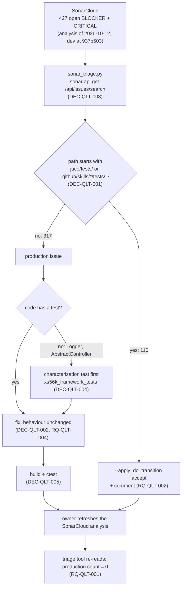

# ADR-QLT-001: How the SonarCloud BLOCKER and CRITICAL Issues Are Handled

## Status
Accepted — drafted in session QLT (2026-10-11, counts updated 2026-10-12 after the owner recreated the SonarCloud project) for FTR-QLT-001 (RQ-QLT-001 to RQ-QLT-008), after the owner's
decision that the issues of test code are accepted in SonarCloud with a description and not fixed; reviewed and accepted by the owner on 2026-10-12. Implementation is PLAN-QLT-001 and PLAN-QLT-002.

## Context

SonarCloud lists 427 open issues of severity BLOCKER (46) or CRITICAL (381) on `xplorer2716_XS56K` (RQ-QLT-001). Read with the `sonar` CLI on 2026-10-12, from the analysis of `dev` at `937b503`:

- **110 are on test code** (`juce/tests/**`, `.github/skills/*/tests/**`): `cpp:S3608` x72, `cpp:S3776` x13, `cpp:S1669` x11, `cpp:S134` x8, `cpp:S1186` x4, `cpp:S5421` x1, `cpp:S3624` x1.
  The owner's decision: test code is the subject of many automated changes, so these are accepted, not fixed (RQ-QLT-002).
- **317 are on production code** (273 in `juce/mcp/src`):

| Rule | Count | Where |
|---|---|---|
| `cpp:S3608` + `cpp:S5019` (explicit lambda captures) | 121 + 120 | `SamplerGateway.cpp` (65 + 64), `SamplerGatewayDisk.cpp` (30 + 30), `SamplerGatewayFx.cpp` (12 + 12), `SamplerGatewayLists.cpp` (9 + 9), `SamplerGatewayKeys.cpp` (5 + 5): about 121 lambdas, two rules each |
| `cpp:S1669` BLOCKER (a name that is a C++20 keyword: `module`) | 30 | `Tools.cpp` 7, `MultiFxPrimitives.hpp` 6, `MultiFxPrimitives.cpp` 6, `SamplerGatewayFx.cpp` 5, `SamplerGateway.hpp` 4, `FxCatalogue.hpp` 1, `FxCatalogue.cpp` 1 |
| `cpp:S3776` (cognitive complexity, 25 allowed) | 16 | `Tools.cpp` 12 (from 31 to 236), `SamplerGateway.cpp` 3, `ServerOptions.cpp` 1 |
| `python:S3776` (15 allowed) | 14 | `generate_sysex_coverage.py` 10, `generate_akm_items.py` 2, `build_sysex_index.py` 2 (one at 137) |
| `cpp:S5421` | 4 | `Logger.cpp` |
| `cpp:S134` | 3 | `Tools.cpp` 2, `AbstractControllerDevices.cpp` 1 |
| `pythonsecurity:S2083` BLOCKER | 2 | `--output` of `generate_sysex_coverage.py` and `generate_akm_items.py` |
| `cpp:S3491` BLOCKER | 2 | `ItemCatalogue.cpp` (both lookups) |
| `cpp:S3624` | 2 | `MockMidiBackend.cpp` |
| `cpp:S5404` BLOCKER, a bug | 1 | `RealScheduler::run` calls `wait(lock)` with no predicate |
| `cpp:S1048`, a bug | 1 | `SamplerGateway::~SamplerGateway` calls `close()`, which may throw |
| `cpp:S1186` | 1 | `NullDiagnosticSink::report` |

Five facts shape the decisions:

1. **The analysis is current today and will not stay so.** The owner deleted and recreated the project on 2026-10-12; its analysis is of the head of `dev`. How SonarCloud is fed is not known
   (no `sonar-project.properties`, no workflow that names Sonar), so whether a push refreshes it is not known either.
2. **The data is large**; the owner asked for a tool to sort it rather than the data in an assistant's context.
3. **Some of the code has no test**: `juce/framework` (`Logger`, `AbstractController`), `juce/midi` and `documents/_index` have none in `juce/tests`. `juce/mcp` and `juce/akm` are well tested
   (`xs56k_akm_tests`, `xs56k_mcp_tests`, the scripted conversations of the simulated server). AGNOS asks for a test before a Tier M change (RQ-QLT-005).
4. **Several checks read the sources**: `CheckNoDestructiveCalls.cmake`, `CheckReadmeCoversTools.cmake` and `generate_sysex_coverage.py --check` (which scans the AKM functions and the MCP gateway). A refactoring that moves code
   can break them without changing behaviour, so they are part of every acceptance criterion on `juce/akm` and `juce/mcp`.
5. **`sonar analyze --file` does not check the rules on this connection.** The CLI (v1.9.0) has it, but against SonarCloud it only looks for secrets and says "Vortex analysis is not available on this connection" (tried on 2026-10-12 on `RealScheduler.cpp`). The only analysis of the rules is SonarCloud's own.

## Decision

### DEC-QLT-001: Test code is accepted by a path rule, not fixed
An issue is on test code when the path of its file starts with `juce/tests/` or with `.github/skills/<skill>/tests/`. Such an issue gets the SonarCloud
transition `accept` with the comment "Not fixed on purpose: test code, whose style is not worth the churn of its automated changes (owner decision 2026-10-11, RQ-QLT-002, DEC-QLT-001)."
- **Why a path rule.** It needs no judgement per issue and keeps working when the analysis finds new test-code issues.
- **Mock backends are production code.** `juce/midi/src/MockMidiBackend.cpp` is a source of the `xs56k_midi` library, outside the two trees; its two `cpp:S3624`
  are fixed by deleting the copy operations (two lines per class). The owner can move it to the test side by adding its path to the rule.
- **Not done.** No exclusion property and no `// NOSONAR` in code: the owner asked to accept in SonarCloud, which leaves the source untouched.

### DEC-QLT-002: Production issues are fixed, one rule family per task; an acceptance is the owner's decision
Each family of production issues is one task of PLAN-QLT-001, with the smallest change that removes the rule, and no change of behaviour (RQ-QLT-004):

| Rule | Change |
|---|---|
| `cpp:S5404` | `_wake.wait(lock)` becomes the form with a predicate that rechecks the state the loop reads (`_stopping` and the queue's next deadline), so a wake-up with nothing to do goes back to waiting |
| `cpp:S3491` | both `&*found` of `ItemCatalogue.cpp` become `std::to_address(found)`, which holds for a pointer and for the class iterator of MSVC's `std::array` alike |
| `cpp:S1186` | the empty body of `NullDiagnosticSink::report` gets a comment that says it drops every diagnostic by design |
| `cpp:S3624` | `MockInputPort` and `MockOutputPort` delete their copy constructor and copy assignment |
| `cpp:S5421` | the file-local mutable state of `Logger.cpp` moves into one struct, reached through one function that returns a reference to a function-local object |
| `cpp:S134` | the CC branch of `automationInputDeviceChannelMessageReceived` moves into a private member that applies one automated parameter |
| `cpp:S3776`, `cpp:S134` (production) | the function is cut into named steps (DEC-QLT-008) |
| `python:S3776` | the functions of `generate_akm_items.py`, `generate_sysex_coverage.py` and `build_sysex_index.py` are cut into named steps (DEC-QLT-008) |
| `cpp:S3608`, `cpp:S5019` | each lambda gets an explicit capture list (DEC-QLT-006) |
| `cpp:S1669` | the parameter or variable `module` is renamed (DEC-QLT-007) |
| `cpp:S1048` | `~SamplerGateway` no longer lets `close()` throw: it catches and drops the exception, as a destructor must |
| `pythonsecurity:S2083` | the owner decides (DEC-QLT-009) |

If a fix would change behaviour or cannot be verified (RQ-QLT-003), the task stops and the owner decides; an acceptance then carries his reason in its comment.

### DEC-QLT-003: A triage tool, `juce/tools/sonar_triage.py`, over `sonar api`
The script calls `sonar api get /api/issues/search` (the CLI holds the token in the OS keychain; the script never sees one), pages through the result,
keeps the raw reply in a file outside the repository (a path given by `--cache`, in the temp directory by default), and prints counts by rule and by file plus the list of production issues.
- **Classification is a pure function** of the issue's path, tested with no network; the call to the CLI is a function the tests replace (RQ-QLT-006).
- **`--apply` is the only mode that writes.** Without it the script says what it would send. Each transition is `sonar api post /api/issues/do_transition`
  with `{"issue": <key>, "transition": "accept", "comment": ...}`; an issue already `ACCEPTED` is skipped, so a second run sends nothing (RQ-QLT-008).
- **The project key, the organization and the paths of DEC-QLT-001 are named constants** at the top of the script; the severities are an argument.
- **Tests** are `unittest` tests in `juce/tests/tools/test_sonar_triage.py`, run by a `ctest` entry of their own (`unittest discover -p`), as the tests of the other tools are.

### DEC-QLT-004: Untested code gets a characterization test, in a new target `xs56k_framework_tests`
`juce/tests/framework/` is a new test executable (Catch2, like `xs56k_akm_tests`) linked to `xs56k_framework` and `xs56k_midi`, with the mock backend of `xs56k_midi`. It holds the
Gherkin-named tests that pin what `Logger` and `AbstractController` do today, written before DEC-QLT-002's fixes of them and passing before and after.
`documents/_index` is not given a unit test: it needs `pymupdf` and a 42-page PDF; the byte-identical regeneration of `sysex_spec.items.tsv` and `sysex_spec.clean.txt` is its test (RQ-QLT-005).

### DEC-QLT-005: A fix is checked by the build and the tests; SonarCloud's own analysis is the last word and is the owner's to refresh
The local analyser cannot say whether a rule is still reported (fact 5), so a fix is checked by what the repository can run: the build (warning-clean, `/WX`), the whole `ctest` suite (with the source checks of fact 4),
and the test written for it. Each task says "checked by the build and the tests, not by Sonar" until SonarCloud has analysed a revision that holds the fix. RQ-QLT-001 is closed only after such an analysis
(a pull request's, or `dev` after the merge), read with the tool of DEC-QLT-003; the project's analysis is of `dev` at `937b503` and the fixes live on `feature/QLT`.
Whether a push refreshes the analysis, and which setting or workflow feeds SonarCloud, is an open question for the owner; until it is answered, the plans end with RQ-QLT-001 "checked locally, not by SonarCloud".

### DEC-QLT-006: A lambda gets the capture list of what its body uses, never a catch-all
`cpp:S3608` and `cpp:S5019` flag the same lambdas (`[&]`, `[=]` and friends). Each is rewritten with the explicit list: the variables its body names, by reference unless the lambda outlives the scope
(then by value), and `this` written out when a member is used. The list is found by the compiler (a missing name is an error), not by reading; a lambda is never changed to capture more than it used.
- **One task per file group** (`SamplerGateway.cpp`; `SamplerGatewayDisk.cpp`; `Fx`, `Lists` and `Keys`), so that a review reads one file's lambdas.
- **Not done.** No `// NOSONAR`; no helper that wraps lambdas; no change of what a lambda does.

### DEC-QLT-007: `module` is renamed where it is a parameter or a variable
`cpp:S1669` flags `module` as a name because it is a contextual keyword of C++20. The 30 production occurrences are parameters and locals of the effects code (an index of an effects module): they
become `moduleIndex`. In a public header only the parameter name changes, which no caller can see; a Doxygen comment that names it follows.

### DEC-QLT-008: A function above the limit is cut into named steps, with its behaviour pinned by the tests that already exist
`cpp:S3776` and `cpp:S134` ask for smaller functions: each flagged function is cut along the steps its body already has, each step a named function in the same file's anonymous namespace (C++) or module (Python),
with no new public name and no change of an output. The tests of `juce/akm` and `juce/mcp`, the scripted conversations, and the source checks of fact 4 are the net; where there is none (DEC-QLT-004), a test comes first.
- **The largest functions** (`Tools.cpp` at 236 and 170, `build_sysex_index.py` at 137) are tasks of their own, or are cut in groups with a `ctest` after each.

### DEC-QLT-009: The path traversal alerts of the generators are the owner's to decide
`pythonsecurity:S2083` flags `args.output.write_text(...)` in `main()` of `generate_sysex_coverage.py` and `generate_akm_items.py`: the path comes from `--output`. Both are developer tools run at a shell, which
write where they are told, and the unit tests give them a path in a temporary directory, so restricting the path to the repository would change what they do and break the tests (RQ-QLT-003). The recommended
decision is to accept the two in SonarCloud with that reason; the alternative is a check that `--output` is inside the repository or the system temporary directory. The task asks the owner and does one of the two.

## Consequences

**Easier.** The 30 test-code issues are closed by one run of a tool, and a later analysis that finds more is handled by running it again. The one BLOCKER bug
(`S5404`) is fixed on its own, with the scheduler's tests around it. `juce/framework` gets a first test target, which later work on that library can use.

**Harder.** About 320 sites are touched, most in `juce/mcp`, with no change of behaviour allowed: the work spans two plans and several sessions, and each fix has to keep three source checks passing. A new test executable and its CMake entry have to be kept up to date. `Logger` and `AbstractController` are pinned by tests that did not exist, so
they pin today's behaviour, errors included. Refactoring `build_sysex_index.py` (complexity 137) has no unit test and needs `pymupdf` and the PDF on the machine of
whoever runs it.

**Unknown until run.** Whether `std::to_address` on MSVC's iterator satisfies `cpp:S3491`; whether a refactoring of `Tools.cpp` keeps `generate_sysex_coverage.py --check` green, since that script reads the tool and gateway sources; whether the predicate form of `wait`
satisfies `cpp:S5404` the way it is written (the local analyser tells).

## Alternatives Considered

- **Fix the test code too.** Rejected by the owner: the test code changes by automation, so the fixes would conflict or be undone.
- **Exclude the test trees from the analysis (`sonar.issue.ignore.multicriteria` or `sonar.exclusions`).** Rejected for now: the owner asked to accept in SonarCloud with a
  description; an exclusion also hides the test code from every other rule, and the project has no Sonar properties file to hold it.
- **Mark the test files as tests (`sonar.test.inclusions`).** Does not remove an issue; the rules still apply.
- **`// NOSONAR` comments.** Rejected: they touch the source, which is what DEC-QLT-001 avoids, and they hide the rule from the reader of SonarCloud with no reason.
- **Accept the production issues too.** Rejected: two bugs, 30 renames and 241 mechanical capture lists are cheap to verify and better fixed (RQ-QLT-003 keeps the way out).
- **Rewrite the 121 lambdas with a script.** Rejected: the right list depends on how long the lambda lives; the compiler is the checker and a person (or an assistant) the author, file by file.
- **Keep the triage in a throwaway script outside the repository.** Rejected: the acceptance must be repeatable after each analysis (RQ-QLT-008), so it has to be reviewed and tested.

## Diagram

