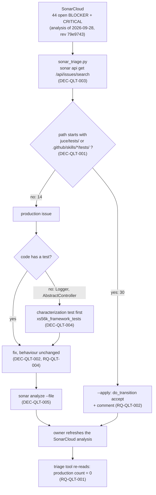

# ADR-QLT-001: How the SonarCloud BLOCKER and CRITICAL Issues Are Handled

## Status
Proposed — drafted in session QLT (2026-10-11) for FTR-QLT-001 (RQ-QLT-001 to RQ-QLT-008), after the owner's decision that the issues of test
code are accepted in SonarCloud with a description and not fixed. Awaiting the owner's review; implementation is PLAN-QLT-001.

## Context

SonarCloud lists 44 open issues of severity BLOCKER (2) or CRITICAL (42) on `xplorer2716_XS56K` (RQ-QLT-001). Read with the `sonar` CLI:

- **30 are on test code** (`juce/tests/**`, `.github/skills/*/tests/**`): `cpp:S3608` x20, `cpp:S3776` x3, `cpp:S1186` x4, `cpp:S3624` x1,
  `cpp:S134` x1, `cpp:S5421` x1. The owner's decision: test code is the subject of many automated changes, so these are accepted, not fixed (RQ-QLT-002).
- **14 are on production code**: `cpp:S5404` (BLOCKER, a bug: `RealScheduler::run` calls `wait(lock)` with no predicate), `cpp:S3491` (BLOCKER,
  `&*found` in `ItemCatalogue.cpp`), `cpp:S5421` x4 (`Logger.cpp`), `cpp:S3624` x2 (`MockMidiBackend.cpp`), `cpp:S1186` x1 (`DiagnosticSink.hpp`),
  `cpp:S134` x1 (`AbstractControllerDevices.cpp`), `python:S3776` x4 (`generate_akm_items.py` x2, `documents/_index/build_sysex_index.py` x2, one of them
  with a cognitive complexity of 137).

Four facts shape the decisions:

1. **The analysis is stale.** The only SonarCloud analysis is of 2026-09-28 (`dev`, revision `79e9743`); `dev` has 258 commits since, among them `juce/mcp`.
   There is no `sonar-project.properties` and no workflow that names Sonar, so how the project is fed is not known (it looks like SonarCloud's own automatic analysis, which has not
   run since). Of the files of the 14 issues, `ItemCatalogue.cpp` and `generate_akm_items.py` changed after the analysis.
2. **The data is large and goes stale quickly**; the owner asked for a tool to sort it rather than the data in an assistant's context.
3. **Some of the code has no test**: `juce/framework` (`Logger`, `AbstractController`), `juce/midi` and `documents/_index` have none in `juce/tests`
   (`xs56k_akm_tests`, `xs56k_mcp_tests` and the Python tests of `juce/tools` are the whole suite). AGNOS asks for a test before a Tier M change (RQ-QLT-005).
4. **`sonar analyze --file`** exists in the CLI (v1.9.0) and gives an immediate answer for one file, with no push.

## Decision

### DEC-QLT-001: Test code is accepted by a path rule, not fixed
An issue is on test code when the path of its file starts with `juce/tests/` or with `.github/skills/<skill>/tests/`. Such an issue gets the SonarCloud
transition `accept` with the comment "Not fixed on purpose: test code, whose style is not worth the churn of its automated changes (owner decision 2026-10-11, RQ-QLT-002, DEC-QLT-001)."
- **Why a path rule.** It needs no judgement per issue and keeps working when the analysis finds new test-code issues.
- **Mock backends are production code.** `juce/midi/src/MockMidiBackend.cpp` is a source of the `xs56k_midi` library, outside the two trees; its two `cpp:S3624`
  are fixed by deleting the copy operations (two lines per class). The owner can move it to the test side by adding its path to the rule.
- **Not done.** No exclusion property and no `// NOSONAR` in code: the owner asked to accept in SonarCloud, which leaves the source untouched.

### DEC-QLT-002: Production issues are fixed, one rule family per task; an acceptance is the owner's decision
Each family of production issues is one task of PLAN-QLT-001, with the smallest change that removes the rule, and no change of behaviour (RQ-QLT-004):

| Rule | Change |
|---|---|
| `cpp:S5404` | `_wake.wait(lock)` becomes the form with a predicate that rechecks the state the loop reads (`_stopping` and the queue's next deadline), so a wake-up with nothing to do goes back to waiting |
| `cpp:S3491` | `&*found` becomes `std::to_address(found)`, which holds for a pointer and for the class iterator of MSVC's `std::array` alike |
| `cpp:S1186` | the empty body of `NullDiagnosticSink::report` gets a comment that says it drops every diagnostic by design |
| `cpp:S3624` | `MockInputPort` and `MockOutputPort` delete their copy constructor and copy assignment |
| `cpp:S5421` | the file-local mutable state of `Logger.cpp` moves into one struct, reached through one function that returns a reference to a function-local object |
| `cpp:S134` | the CC branch of `automationInputDeviceChannelMessageReceived` moves into a private member that applies one automated parameter |
| `python:S3776` | `validate` and `coverage` of `generate_akm_items.py`, and the two functions of `build_sysex_index.py`, are cut into named steps |

If a fix would change behaviour or cannot be verified (RQ-QLT-003), the task stops and the owner decides; an acceptance then carries his reason in its comment.

### DEC-QLT-003: A triage tool, `juce/tools/sonar_triage.py`, over `sonar api`
The script calls `sonar api get /api/issues/search` (the CLI holds the token in the OS keychain; the script never sees one), pages through the result,
keeps the raw reply in a file outside the repository (a path given by `--cache`, in the temp directory by default), and prints counts by rule and by file plus the list of production issues.
- **Classification is a pure function** of the issue's path, tested with no network; the call to the CLI is a function the tests replace (RQ-QLT-006).
- **`--apply` is the only mode that writes.** Without it the script says what it would send. Each transition is `sonar api post /api/issues/do_transition`
  with `{"issue": <key>, "transition": "accept", "comment": ...}`; an issue already `ACCEPTED` is skipped, so a second run sends nothing (RQ-QLT-008).
- **The project key, the organization and the paths of DEC-QLT-001 are named constants** at the top of the script; the severities are an argument.
- **Tests** are `unittest` tests in `juce/tests/tools/test_sonar_triage.py`, run by a `ctest` entry of their own (`unittest discover -p`), as the tests of the other tools are.

### DEC-QLT-004: Untested code gets a characterization test, in a new target `xs56k_framework_tests`
`juce/tests/framework/` is a new test executable (Catch2, like `xs56k_akm_tests`) linked to `xs56k_framework` and `xs56k_midi`, with the mock backend of `xs56k_midi`. It holds the
Gherkin-named tests that pin what `Logger` and `AbstractController` do today, written before DEC-QLT-002's fixes of them and passing before and after.
`documents/_index` is not given a unit test: it needs `pymupdf` and a 42-page PDF; the byte-identical regeneration of `sysex_spec.items.tsv` and `sysex_spec.clean.txt` is its test (RQ-QLT-005).

### DEC-QLT-005: A fix is checked locally by the analyser; SonarCloud's own analysis is the last word and is the owner's to refresh
Each fix task runs `sonar analyze --file <file>` on the files it changed and reports the rule's presence. This does not replace SonarCloud: its
analysis does not follow pushes. RQ-QLT-001 is closed only after an analysis of a revision that holds the fixes, read with the tool of DEC-QLT-003. Which setting or workflow
feeds SonarCloud is an open question for the owner; until it is answered, the plan ends with RQ-QLT-001 "checked locally, not by SonarCloud".
- **After the refresh** the list may hold issues in code SonarCloud has never seen (the `juce/mcp` server). They are not part of FTR-QLT-001; the tool lists them and the owner chooses.

## Consequences

**Easier.** The 30 test-code issues are closed by one run of a tool, and a later analysis that finds more is handled by running it again. The one BLOCKER bug
(`S5404`) is fixed on its own, with the scheduler's tests around it. `juce/framework` gets a first test target, which later work on that library can use.

**Harder.** A new test executable and its CMake entry have to be kept up to date. `Logger` and `AbstractController` are pinned by tests that did not exist, so
they pin today's behaviour, errors included. Refactoring `build_sysex_index.py` (complexity 137) has no unit test and needs `pymupdf` and the PDF on the machine of
whoever runs it.

**Unknown until run.** What a fresh analysis finds on `dev`; whether `std::to_address` on MSVC's iterator satisfies `cpp:S3491`; whether the predicate form of `wait`
satisfies `cpp:S5404` the way it is written (the local analyser tells).

## Alternatives Considered

- **Fix the test code too.** Rejected by the owner: the test code changes by automation, so the fixes would conflict or be undone.
- **Exclude the test trees from the analysis (`sonar.issue.ignore.multicriteria` or `sonar.exclusions`).** Rejected for now: the owner asked to accept in SonarCloud with a
  description; an exclusion also hides the test code from every other rule, and the project has no Sonar properties file to hold it.
- **Mark the test files as tests (`sonar.test.inclusions`).** Does not remove an issue; the rules still apply.
- **`// NOSONAR` comments.** Rejected: they touch the source, which is what DEC-QLT-001 avoids, and they hide the rule from the reader of SonarCloud with no reason.
- **Accept the production issues too.** Rejected: a BLOCKER bug and eleven refactorings that are cheap to verify are better fixed (RQ-QLT-003 keeps the way out).
- **Keep the triage in a throwaway script outside the repository.** Rejected: the acceptance must be repeatable after each analysis (RQ-QLT-008), so it has to be reviewed and tested.

## Diagram

