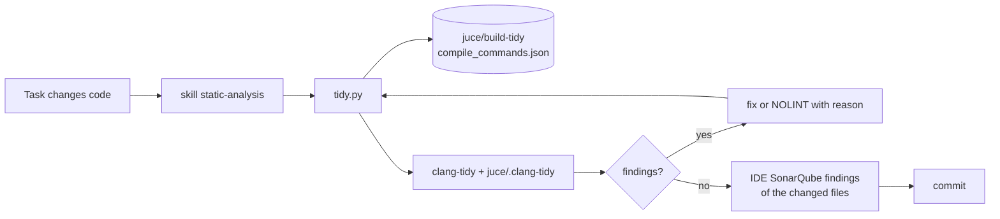

# ADR-QLT-002: clang-tidy Before the Commit — One Configuration, One Tool, One Skill

## Status
Accepted — drafted in session APP (2026-10-16) for FTR-QLT-002 (RQ-QLT-009 to RQ-QLT-013), on the owner's request to specify and implement it. Implementation is PLAN-QLT-004.

## Context

Pull request 18 needed five passes of SonarCloud fixes (PLAN-QLT-003). About three quarters of its production issues came from six C++20 idioms, and some of the later passes were
made by the fixes of the earlier ones, because nothing checked a fix before it was pushed. The facts:

1. **SonarCloud is the free plan**: the quality profile, the test-code exclusions and the rule set cannot be tuned per project the way it would need (owner, 2026-10-16).
2. **`sonar analyze --file` checks only secrets** on this connection (ADR-QLT-001, fact 5).
3. **clang-tidy is on the owner's machine**: Visual Studio ships it (`VC/Tools/Llvm/x64/bin/clang-tidy.exe`, LLVM 22.1). It needs a compile database, which the Visual Studio
   generator of `juce/build` does not write; a Ninja configuration in the developer environment does (`juce/build-tidy`, tried 2026-10-16: 63 s, no build needed). The compile
   commands carry no `/EHsc`, so clang-tidy, which reads them, must be given it.
4. **The IDE's SonarQube plugin applies the real rules**, Python included, and its findings are readable by the AI through VS Code's Problems panel, for the files that are open.
5. **Some Sonar rules have no clang-tidy check**: `S7172` (`has_value()`), `S6004` (init-statement), `S6177` (`using enum`), `S6225` (`std::to_address`), `S3491` (`&*`),
   `S1188` (lambda length), `S6045` (`std::less<>`), `S3574`, and every Python rule.

## Decision

### DEC-QLT-010: `juce/.clang-tidy`, the checks of the rules met, every finding an error
One file at `juce/.clang-tidy`. Its checks, each commented with its Sonar rule: `bugprone-exception-escape` (S1048), `bugprone-empty-catch` (S108, S2486),
`performance-unnecessary-value-param` (S1238), `performance-move-const-arg` (S5415), `modernize-use-ranges` (S6197), `readability-container-contains` (S6171),
`modernize-use-emplace` (S6003), `modernize-avoid-c-arrays` (S5945), `modernize-use-auto` for casts (S5827), `modernize-loop-convert` (S5566),
`readability-function-cognitive-complexity` at Sonar's C++ threshold of 25 (S3776); and three bug finders: `bugprone-use-after-move`, `bugprone-dangling-handle`,
`performance-unnecessary-copy-initialization`. `WarningsAsErrors: '*'`. The header filter keeps the project's directories and leaves out `_deps` (JUCE) and the generated files.
`modernize-use-std-format` is not enabled: the Linux CI runner is pinned to ubuntu-22.04, whose GCC 11 has no `<format>` (`midiapp::service::formatStr`
is the portable form). Bug-prone `exception-escape` is limited to destructors and `noexcept` functions (`CheckMoveMemberFunctions` and `CheckMain` off): Sonar's S1048 is about destructors, and
the implicit moves of lambdas' captures are noise.

### DEC-QLT-011: `juce/tools/tidy.py` over a Ninja compile database in `juce/build-tidy`
The tool finds clang-tidy (`--clang-tidy`, then the `CLANG_TIDY` variable, then the `PATH`, then Visual Studio's copy through `vswhere`), and the compile database of
`juce/build-tidy`. When there is none it configures that directory with Ninja and `CMAKE_EXPORT_COMPILE_COMMANDS` (on Windows inside `vcvars64`, Ninja being Visual Studio's own);
only the generated header the sources include (`XS56KAppFonts`'s `BinaryData.h`) is built. `--fix` applies clang-tidy's own fixes, one source at a time;
`--tests` includes the test code, for the automatic fixes on the owner's request. It adds `/EHsc` for an MSVC command. It runs the files in parallel and prints only the findings in the project's files, each once (a header's finding comes from
every source that includes it).

### DEC-QLT-012: What is checked — what changed, against the base branch
With no argument: the production `.cpp`, `.hpp` and `.h` files of `juce/` (`juce/tests/` and generated files left out, DEC-QLT-001) that differ from the merge base with
`origin/dev` (commits of the branch, staged, unstaged and untracked); a header is checked through the sources of the compile database that include it by name. Named files are
checked as given; `--all` checks every production source of the database.

### DEC-QLT-013: Part of every task, through a skill named in `AGENTS.md`
The skill `static-analysis` (`.github/skills/static-analysis/SKILL.md`, a pointer under `.claude/skills/`) says when and how: before the commit of a task that changed code of `juce/`,
run `tidy.py`, fix each finding or justify it with a `NOLINT(check)` and its reason, and cite the result in the task's Verification. It is not part of the AGNOS files, which stay
as they are; `AGENTS.md` names it in one line of its commands. CI does not run it yet: the owner decides once its noise is known.

### DEC-QLT-014: The rules clang-tidy lacks, from the IDE and from a list of idioms
For the rules of fact 5, the skill's second step opens the changed files in VS Code (`code -r <files>`) and reads the Problems panel's `sonarqube` findings, when the IDE is
reachable. The skill also lists the idioms those rules ask for, so that the code is written right the first time.

## Consequences

- A task's issues are seen in its own diff, before the push; a fix that makes a new issue is seen too.
- The first run on the whole production code finds what SonarCloud did not raise yet; it is fixed once (RQ-QLT-011).
- `juce/build-tidy` is a second configured tree on the disk (ignored by git, as `juce/build*`), configured in about a minute and never built.
- On Linux and macOS the tool needs clang-tidy and Ninja installed; it says so and exits 2 when they are missing.

## Alternatives Considered

- **Tuning SonarCloud**: the free plan does not allow it (fact 1).
- **`sonar analyze --file`**: checks only secrets here (fact 2).
- **`CMAKE_CXX_CLANG_TIDY` in the build**: every build would run clang-tidy on every file, JUCE's compiled sources included, several times slower; and the Visual Studio generator does not support it for MSVC.
- **The IDE's plugin alone**: it sees only the open files, and is not scriptable outside VS Code; it stays as the second step (DEC-QLT-014).

## Diagram

